# Worldgen vision

The worldgen phase of Eternal Return. This is the target; the status section further down tracks where things stand.

## Terrain

Overworld terrain with the weirdness of Beta 1.7.3 combined with the large continents and big oceans of Release 1.6.4.

## Biomes

A small biome list: mostly the Release 1.6.4 biomes, plus a few added in later versions. Which later biomes make the cut is the project owner's call. Chosen so far: birch forest, savanna, badlands, dark forest and cherry grove, this mod's own autumnal forest, the old growth pine and spruce taigas (as rare patches inside taigas), and every modern ocean (deep, warm, lukewarm, cold, frozen). The worldgen expansion adds the brief's new biomes as sub-biomes of these (see New biomes).

## Caves

Inspired by TheMasterCaver's World. Many cave types:

- spaghetti
- ravine
- ~~maze~~ (dropped, not planned)
- zig-zag
- vertical
- ribbed
- ~~random / combination~~ (dropped, not planned)
- large
- ~~circular room~~ (dropped, not planned)
- spiral
- toroidal room

Cave stone depends on the biome (sandstone caves in deserts; granite, diorite, andesite and others elsewhere), and each stone has its own ore variants. Both are in place (see Biome stone and Ore variants below).

Built: spaghetti, ravine, large, vertical, zig-zag, ribbed, spiral and toroidal room (see The cave engine below). Maze, combination and circular-room caves were dropped from the plan.

No modern cave biomes (lush caves, dripstone caves, deep dark) and no deepslate. The full modern height (-64 to 320) is used.

## Scope

- The overworld, and the outer End (see The outer End). The Nether is left alone.
- Everything lives in this one mod, in its own worldgen package (`com.eternalreturn.worldgen`).
- Every feature gets its own on/off toggle in `config/eternalreturn.json`.
- Follow the repo's existing conventions: tags and data under `data/eternalreturn`, the existing config style, and README updates alongside each feature.

## Compatibility

Must keep working alongside Sodium, Nostalgic Tweaks and Moderner Beta.

## Current setup

Worldgen comes from Moderner Beta (`moderner-beta-fabric-5.0.0-alpha.2+1.21.1`) with this mod's own preset on top: World Type "Eternal Return" on the create-world screen (world preset `eternalreturn:eternal_return`, Moderner Beta settings preset `eternalreturn:eternal_return`). Moderner Beta is a runtime-only dependency in the dev environment, so the build never depends on it.

The preset is all data. Without Moderner Beta installed, the world type and its noise settings are skipped at load time (Fabric load conditions), the jar still launches, and worlds still load. The `gametestNoModernerBeta` run checks this.

## Status

- Phase 1 (investigation): done. Findings below.
- Phase 2 (preset, fish tags, terrain): done. Biome list, no cave biomes, no deepslate, full -64 to 320 height, terrain tuned in four passes (the second, third and fourth after playtesting; since the fourth the biome no longer shapes the land).
- Phase 3, part 1 (cave engine): done. The shared engine, debug tools and six tunnel types; the old caves are off in Eternal Return worlds; trial chambers removed there. Ores are still vanilla's.
- Phase 3, part 2: done. Spiral and toroidal-room caves; maze, combination and circular-room caves dropped.
- Phase 4, part 1 (biome stone): done. Each biome's stone from under the topsoil to bedrock, and two hardened blocks.
- Phase 4, part 2 (ore variants): done. Every ore in every host stone, with old-style textures.
- Terrain features: done. Deep oceans that fall in steps, rare sinkholes (mostly in the sea, about 100 blocks across), rare floating islands, old growth taigas, extremely rare monoliths, mushrooms in caves (see Terrain features).
- Worldgen expansion (the owner's brief of 2026-11-01, seven phases, each checked in game before the next): phase 1 (clutter: boulders) done, see Clutter; phase 2 (biome trees) done, see Biome trees; phase 3 (biome variants) done, see Biome variants; phase 4 (terrain landmarks) done, see Terrain landmarks; phase 5 (climate rules) done, see Climate rules (checked in game by the owner on 2026-11-02: "everything looks good"); phase 6 (new biomes) in batches, see New biomes: batches A (temperate), B (dry) and C (cold) done (checked in game by the owner); then, on the owner's request, ice caves, the ice blocks and the icy mountains on the high ground, built, waiting for the owner's in-game check; next D (tropical, ocean, fantasy).
- Phase 4, part 3 (biomes and mineshafts): done. Cherry groves, every modern ocean, and mineshafts built from their biome's wood. Ocean monuments and Moderner Beta's ocean shrines were later removed from Eternal Return worlds; guardians spawn in the open sea instead (README, Mobs and Fishing).

## The Eternal Return preset

`tools/worldgen/build_preset.py` builds it from Moderner Beta's Release 1.6.4 preset (read straight from the Moderner Beta jar in the Gradle cache) and applies the changes below. The terrain knobs and the biome stone table are in `tools/worldgen/knobs.json`: edit them, run `python tools/worldgen/build_preset.py tools/worldgen/knobs.json`, and the files under `src/main/resources` are rewritten.

| File | What it is |
|---|---|
| `data/eternalreturn/moderner_beta/settings_preset/eternal_return.json` | the Moderner Beta settings: biome layers, terrain knobs, no cave biomes, no deepslate |
| `data/eternalreturn/worldgen/noise_settings/eternal_return.json` | Moderner Beta's `overworld_256` noise settings with the height opened up to -64..320, plus the biome stone surface rules (from `biome_stone` in the knobs) |
| `data/eternalreturn/tags/block/biome_host_stones.json` | every host stone in the biome stone table (see Biome stone) |
| `data/eternalreturn/worldgen/world_preset/eternal_return.json` | the world type; vanilla Nether, End with `eternalreturn:eternal_return_end` |
| `data/eternalreturn/worldgen/noise_settings/eternal_return_end.json`, `data/eternalreturn/worldgen/noise/outer_end.json` | vanilla's End noise settings (from the Minecraft jar in the Loom cache) with the outer End's density and biome functions and the noise up to y 256 (see The outer End) |
| `data/minecraft/tags/worldgen/world_preset/normal.json` | lists the world type on the create-world screen (optional entry) |
| `data/eternalreturn/moderner_beta/settings_preset_category/`, `data/eternalreturn/tags/moderner_beta/`, `data/moderner_beta/tags/moderner_beta/settings_preset_category/selectable.json` | lists the preset in Moderner Beta's own preset picker, with its icon (`assets/eternalreturn/textures/gui/moderner_beta_settings_preset/`) |
| `data/minecraft/tags/block/stone_ore_replaceables.json`, `data/minecraft/tags/block/deepslate_ore_replaceables.json` | move tuff from the deepslate ore tag to the stone one, so ores that land in tuff blobs use their stone variant |
| `structure_modifiers.removed` in the settings preset | `minecraft:trial_chambers`: no trial chambers in Eternal Return worlds |

**Biomes.** The 1.6.4 land pool (desert, forest, extreme hills, swampland, plains, taiga, jungle, each listed twice) plus birch forest, savanna, badlands, dark forest, cherry grove and the autumnal forest (`eternalreturn:autumnal_forest`, this mod's own; each listed once). Old growth pine and spruce taigas turn up as patches inside taigas (see Terrain features). River, frozen river, beach, ice plains, ice mountains, mushroom island, and the hills and shore rules are unchanged from 1.6.4. Birch forest, savanna, badlands and cherry grove get hills variants through the hills layer; dark forest has none, as in later versions, and neither has the autumnal forest: since every land biome shares one height (see Terrain tuning), a hills variant would change nothing. Moderner Beta has no height setting of its own for the autumnal forest; it takes the shared land height like every land biome.

**Oceans.** Every modern ocean, with the steps Moderner Beta's Release 1.17.1 preset uses: right after the mushroom island layer, ocean whose four neighbours are ocean becomes deep ocean (Release 1.7's deep ocean layer); beaches and rivers treat deep ocean as ocean; and last, an ocean temperature noise (Release 1.13's) makes each ocean or deep ocean frozen, cold, plain, lukewarm or warm, softening warm and frozen next to land (deep warm stays as shallow as warm, as in vanilla, where there is no deep warm ocean). The frozen oceans 1.6.4 puts beside its ice plains stay frozen. Over 8,000 x 8,000 blocks of the test seed, oceans are about 40 percent of the area: ocean 9.9, deep ocean 7.7, cold 6.9, lukewarm 4.6, deep cold 3.3, deep lukewarm 2.7, warm 2.0, frozen 1.1 and deep frozen 0.6 percent. Every ocean's height is set in the preset, with Moderner Beta's 1.17.1 values (`-1.0;0.2`, deep ones `-1.8;0.2`, and the deep warm ocean `warm_ocean*deep` as shallow as warm), so the sea floor has no steps where the temperature changes. Without those lines the deep cold, deep frozen and deep lukewarm oceans and the deep warm one, which Moderner Beta's height table leaves out, took the default land height and rose into hills that still reported an ocean biome, with ocean ruins and shipwrecks on dry land. Deep oceans are deeper. Since the terrain features pass the sea floor no longer follows the ocean type at all: it falls in steps with the distance from land (see Terrain features). Vanilla's ocean ruins, shipwrecks and buried treasure follow the ocean types. Later still, Eternal Return worlds kept only strongholds, mineshafts, nether fossils and end cities, in all three dimensions (`EternalReturnServer` filters the structure sets each dimension places once it knows the world is an Eternal Return one; `StructureTests` checks every dimension, and that vanilla still has villages and fortresses). There are no ocean monuments (there were 35 within 4,000 blocks of spawn) and no Moderner Beta ocean shrines: `build_preset.py` removes the monument structure set and drops the shrine override Moderner Beta's presets carry (shrines have no structure set of their own), so guardians spawn in the open sea instead (README, Mobs). `StructureTests` checks that Eternal Return worlds place neither and that vanilla still places monuments.

**Cherry groves** are a normal entry in the land pool, about 2.4 percent of the area (as much as badlands). Moderner Beta gives them a plateau height, which Eternal Return's terrain knobs turned into sheer flat-topped blocks rising from the sea; `build_preset.py` set them to a raised, rolling highland instead (`0.35;0.6`, hills `0.6;0.7`). Since the fourth terrain pass every land biome shares one height, so cherry groves are shaped by the noise like the rest (see Terrain tuning).

The later biomes work cleanly next to Moderner Beta's own: Moderner Beta ships height settings for them and a badlands surface (terracotta bands and red sand), and their vanilla grass and foliage colours and mob spawns apply unchanged. Nothing had to be skipped. Share of land on the test map: ice plains 19% (the same as plain 1.6.4, from its cold climate band), taiga 13%, swampland 11%, forest 11%, desert 8%, plains 7%, badlands 6%, jungle 6%, extreme hills 6%, dark forest 4%, savanna 4%, birch forest 4%, mushroom island 0.2%. The four later biomes together are about a fifth of the land. (Those shares are from before cherry groves and the modern oceans; adding a biome to the pool reshuffles where every land biome lands, so all coordinates in the README checklist were found again.)

**No cave biomes.** The cave biome provider is `moderner_beta:none`, so lush caves, dripstone caves and the deep dark never generate (and so no ancient cities either).

**No deepslate.** Moderner Beta's deepslate layer is off, so below y=0 the stone carries on unchanged (plain stone, or the biome's stone; see Biome stone). Vanilla still scatters tuff blobs below y=0, and an ore that lands in tuff would take its deepslate variant. Tuff is added to `stone_ore_replaceables` and taken out of `deepslate_ore_replaceables` (that file replaces vanilla's, leaving only deepslate), so those ores are always the stone kind; the second change matters once caves expose tuff to air, because vanilla's ore placer then falls back to the deepslate target. Both tag changes apply to every world: in a vanilla world, ores inside tuff blobs use the stone variant too. Trial chambers, which have a little cobbled-deepslate rubble, no longer generate in Eternal Return worlds. Moderner Beta's optional "Deepslate Blobs" datapack would still add deepslate if someone turned it on.

**World height.** -64 to 320, all of it used. Bedrock at -64, solid stone with caves and ores from there to the surface, sea level 63, most land between 65 and 85, hills to about 100 and the tallest mountains around 145, in whichever biome the noise puts them. The open sea floor reaches y -30, sinkholes (mostly under the sea) go down to about y -55, and rare floating islands sit between y 165 and 300, above the highest ground. Moderner Beta's own 1.6.4 presets stop terrain at y=128; this preset lets it go higher, with room to spare up to 320. Don't turn on Moderner Beta's "Reduced Height" datapack with this preset: it moves the floor to y=0 for every world.

## Terrain tuning

Goal: Beta 1.7.3's weird, dramatic land at Release 1.6.4's continent and ocean scale. All maps are seed 173164, 4096 x 4096 blocks centred on 0,0, in `docs/worldgen-maps/`.

| | Beta 1.7.3 | Release 1.6.4 | Eternal Return, third pass | Eternal Return |
|---|---|---|---|---|
| Water (share of the map) | 42.1% | 64.7% | 57.1% | 57.2% |
| Ocean biomes | 0% (Beta has none) | 44.5% | 44.8% | 45.0% |
| Landmasses bigger than a chunk | 337 | 200 | 55 | 69 |
| Land height: median / 90th / 99th percentile / max | 71 / 84 / 105 / 122 | 68 / 78 / 104 / 124 | 71 / 85 / 106 / 170 | 71 / 85 / 102 / 144 |
| Land roughness (average height change between points 4 blocks apart) | 1.42 | 1.31 | 1.56 | 1.58 |
| Steps between neighbouring land columns of 2+ / 4+ / 8+ blocks | 3.7 / 0.9 / 0.3% | 4.1 / 0.6 / 0.1% | 4.8 / 0.6 / 0.2% | 4.4 / 0.6 / 0.1% |
| Land mix: flat / rolling / hilly / mountains / extreme | 29 / 51 / 18 / 2.4 / 0% | 47 / 34 / 16 / 3.6 / 0% | 27 / 48 / 22 / 2.6 / 0.1% | 29 / 48 / 21 / 2.3 / 0% |
| The same biome by biome: flat, lowest to highest biome | 18 to 37% | 10 to 92% | 14 to 68% | 15 to 43% |
| Biome by biome: hilly or mountains, lowest to highest | 8 to 35% | 0 to 63% | 12 to 55% | 8 to 41% |
| Land with an overhang (576 sampled chunks) | 0.5% | 0.6% | 0.4% | 0.4% |
| Air under the ground, per land column (overhangs, arches, floating rock) | 0.07 | 0.15 | 0.09 | 0.04 |

The land mix sorts every mostly-land 32 x 32 block square by its relief (highest minus lowest ground): flat under 8 blocks, rolling 8-19, hilly 20-39, mountains 40-79, extreme 80 or more. Steps, overhangs and air under the ground are counted block by block in 576 chunks spread over the map (see Map tool).

Beta's world is a maze of lakes, inlets and islands with no real oceans, and most of its land rolls. 1.6.4 has real oceans and continents, but half its land is flat. Eternal Return keeps 1.6.4's oceans and coastlines (same ocean-biome share) and makes the land roll like Beta's: mostly rolling ground with gentle hills, steps and cliffs about as often as in Beta, mountains up to about y 145, and the odd overhang. As in Beta, the biome has no say in the shape: flat, rolling and hilly country come and go with the noise, in stretches a kilometre or two across, whatever biome lies on them.

**Fourth pass (the noise shapes the land, not the biome).** Playtesting the third pass: some biomes were always hilly, some always flat and some always rolling. In Beta 1.7.3 the biome has no influence on the shape of the terrain, and that is now the case here for every land biome; oceans and rivers keep their depth, so seas, coastlines and rivers stay where they are, and the biome layout doesn't change. In the third pass extreme hills were hilly or mountainous in 55 percent of their 32-block squares and the flooded swamps flat in 68 percent, while Beta's biomes all sit close together (flat 18 to 37 percent, hilly or mountains 8 to 35).

- **One height for every land biome.** Release 1.6.4 gives each biome its own depth and scale (extreme hills `0.3;1.5`, swamps `-0.2;0.1`, plains `0.1;0.3`, and the hills variants their own), and the forced biome height turns them into the land's height and ruggedness. Now every land biome the biome layers can produce, with its hills, edge and other variants, gets the same height (knob `land_height`, `0.1;0.05`, with contrast 1 and base 0 so it reads as is). `build_preset.py` finds them in the layers itself, so a biome added to the pool later gets it too. Beaches and mushroom island shores, the coast itself, keep their own, and so do oceans and rivers.
- **Hilliness from Beta's scale noise.** Beta 1.7.3 decides how rugged the land is with a slow noise (its scale noise, in waves a kilometre or two across). Moderner Beta has it (`noise_landmass.scale`), and it was off here. Now it is on, at Beta's frequency (`variation` 1.121), with influence 1.0 and offset 0.22: ruggedness about 0.2 where the noise is low (flat country), 0.7 in its middle (rolling) and 1.3 or more at its peaks (hills and the odd mountain). The influence and offset were picked so the overall mix matches Beta's and the land stays as smooth as after the third pass.
- **Water kept out of it.** The scale noise is added everywhere, so on its own it would roughen the sea floor (islets rising out of the sea) and the river beds (bars across rivers). Oceans and rivers keep their depth but get a scale of -1.2 (knob `water_scale`), which cancels the noise there; their floors are left with the 0.22 offset, a little flatter than before (0.28).

Over the whole map (with the autumnal forest in the biome pool, below): each biome's mix now sits as close to the others as in Beta (flat 15 to 43 percent, hilly or mountains 8 to 41; median relief 8 to 17 blocks by biome, Beta 9 to 15), the overall mix is Beta's (29 / 48 / 21 / 2.3 percent against 29 / 51 / 18 / 2.4) and the land is as smooth as before (roughness 1.58, steps of 4 or more blocks 0.6 percent). Water share, ocean biomes and ocean depth are about unchanged (57.2 percent water, 45.0 percent ocean biomes, half the water 15 or more blocks deep). Between the terrain change and the autumnal forest joining the biome pool (which moves every land biome, and with them the river pools of jungles and swamps), about 5.5 percent of the map changed between land and water, as much each way: the old flooded swamps became dry land (1.5 percent of the map on their own), and small ponds and inlets turned up in flat country. The highest ground is y 144 instead of 170. Which biome comes out hillier now depends only on where it lies: on the test map the ice plains and deserts happen to cover mostly calm country (43 and 40 percent flat), the jungles mostly hilly country (41 percent hilly or mountains).

What changes in play:
- **Swamps** are no longer flooded lowland at sea level (1.6.4's swamp height sits below the sea): they are land like any other, with their trees, colours and slimes, and can be flat, rolling or hilly. `land_height_except` (for example `["moderner_beta:early_release_swampland"]`) would give them back their own height.
- **Extreme hills** are no longer always mountainous, and mountains turn up in any biome where the noise peaks. **Emerald ore is rarer.** Moderner Beta's emerald ore only generates from y 95 up, in extreme hills, plains, swamps and ice plains. High ground is about as common as before (3.0 percent of the land at y 95 or higher, against 3.2), but it no longer gathers in the extreme hills, so the ground where emerald can generate fell from 2.3 to 1.1 percent of the land, about half (`ground_at_or_above_y95_by_biome` in the map stats; 0.8 percent before the autumnal forest reshuffled the biomes, so this moves with the biome layout). The emerald survey (see Ore variants) doesn't show it: it looks around the highest extreme hills, which with the autumnal forest's reshuffle happen to rise among other emerald biomes, so it finds 442 emeralds there (403 before). Bringing the rest back would take an emerald feature of Eternal Return's own (Moderner Beta's can't be changed without changing its other worlds).
- **Hills variants** (desert hills, forest hills and so on) keep their place on the biome map but no longer their own height, and cherry groves are no longer raised.

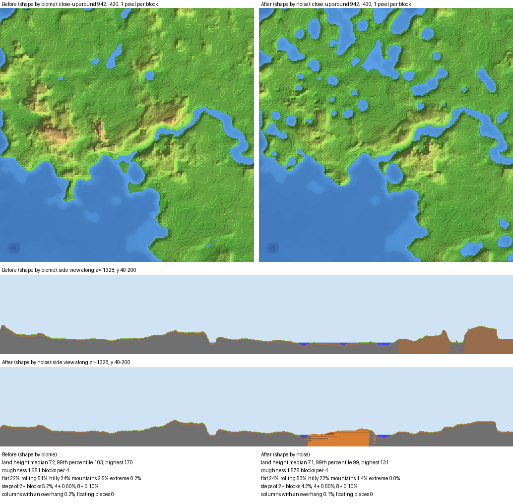

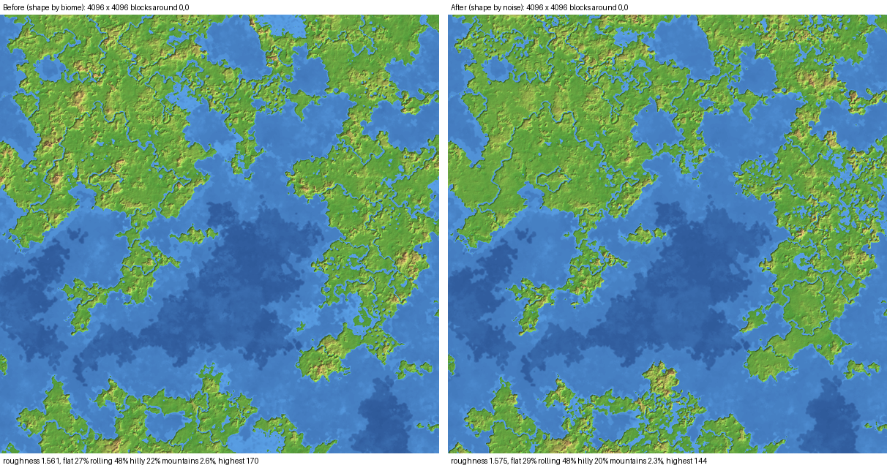

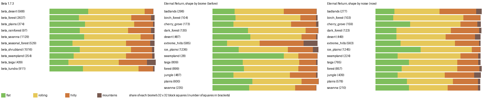

Fourth-pass variants, over the whole 4096 x 4096 map (influence and offset of the scale noise; every land biome at `0.1;0.05`, water scale -1.2; before the autumnal forest joined the biome pool, so the shipped row differs a little from the table above):

| Variant | Influence, offset | Roughness | Steps 2+ / 4+ / 8+ | Flat / rolling / hilly / mountains | Land: median / 99th pct / max | Overhangs | Landmasses |
|---|---|---|---|---|---|---|---|
| Beta 1.7.3 | | 1.42 | 3.7 / 0.9 / 0.3% | 29 / 51 / 18 / 2.4% | 71 / 105 / 122 | 0.5% | 337 |
| Third pass (shape by biome) | (off) | 1.56 | 4.8 / 0.6 / 0.2% | 27 / 48 / 22 / 2.6% | 71 / 106 / 170 | 0.4% | 55 |
| Calm | 0.6, 0.25 | 1.26 | 2.9 / 0.2 / 0.0% | 37 / 50 / 13 / 0.2% | 71 / 94 / 120 | 0.1% | 51 |
| Middle | 0.8, 0.2 | 1.35 | 3.6 / 0.3 / 0.1% | 35 / 49 / 16 / 0.6% | 71 / 97 / 132 | 0.2% | 60 |
| Beta's roughness | 1.0, 0.15 | 1.45 | 4.0 / 0.5 / 0.1% | 33 / 48 / 18 / 1.5% | 71 / 100 / 141 | 0.4% | 77 |
| Wilder | 1.2, 0.1 | 1.56 | 4.5 / 0.7 / 0.2% | 31 / 46 / 20 / 2.9% | 71 / 104 / 154 | 0.6% | 81 |
| **Fourth pass (shipped)** | 1.0, 0.22 | 1.58 | 4.7 / 0.6 / 0.1% | 28 / 48 / 21 / 2.4% | 71 / 102 / 144 | 0.5% | 75 |

A higher influence widens the gap between calm and wild country; the offset lifts all of it. "Beta's roughness" matches Beta's 1.42 but is a little flatter than the third pass; the shipped row keeps the third pass's smoothness with Beta's mix.

The Eternal Return baselines were recorded again, once for both the terrain change and the autumnal forest: the old-caves carving fingerprint (the terrain changed in nearly all its chunks) and the ore census. The census squares each sit inside a biome, so they moved with the reshuffled biomes: coal 17,470 to 16,547 ores (5.3 percent fewer; its upper veins follow the high ground), copper 3.3 percent fewer, iron 2.6, lapis and redstone 1.4 to 1.5, diamond 3.9 percent more, gold the same, and the emerald survey 403 to 442 (above). The control worlds still match their fingerprints and their maps came out the same. With swamps dry, a little more of the cave-density square is underground, so its open share is 5.42 percent (5.28 before; every band below y 64 unchanged).

**Third pass (superseded; smoother, closer to Beta 1.7.3).** Playtesting the second pass found the land rough rather than fantastical: steep steps of two to four blocks almost everywhere, sheer cliffs, flat-topped blocks rising from the forest, and the odd spike or floating bit. The map tool now measures that directly (steps between neighbouring land columns, see Map tool). On the land-rich test area the second pass had 2.7 times Beta 1.7.3's share of 2-block steps and 2.7 times its 4-block steps, and more than twice its hilly ground. Five causes:

- **Base ruggedness everywhere.** The second pass gave every land biome a ruggedness of 0.85 on top of its own, so the noise threw up bumps and ledges in every forest and plain. Now 0.5, with the biome contrast raised from 0.45 to 0.7 so extreme hills and the hills variants still stand out: plains, forests and deserts roll gently (median relief 10 to 14 blocks by biome, Beta 9 to 15), extreme hills keep their mountains (median relief 22, highest ground y 170).
- **Plateau hills.** Jungle hills keep Release 1.6.4's odd height (depth 1.8, scale 0.5), and Moderner Beta's height tags give savanna and badlands hills a plateau (1.8, 0.2). With the land lift they became flat-topped blocks 30 to 40 blocks above the land around them, with sheer sides (the savanna "peak" at y 161 in the old checklist was one). They are now raised, rolling hills, as the cherry groves were before: jungle and savanna hills `0.6;0.8`, badlands hills `0.8;0.5` (`height_overrides` in the knobs).
- **The noise's sudden switches.** Moderner Beta's terrain, like Beta's and 1.6.4's, mixes two 3D noises, and a third decides which one counts where. The switch from one to the other is narrow (`limitBlending` 10), so where the two disagree the ground jumps: in the second pass a 28-block wall stood inside one jungle at x -24, z -1328, with the same biome height on both sides. Blending over a four times wider band (`limitBlending` 40) leaves far fewer and lower walls, fewer overhangs and almost no floating rock: that jungle wall is now an 11-block step and a slope, and the biggest single steps along the side view in the picture below went from 23, 17 and 15 blocks to 11, 7 and 4.
- **River banks.** 1.6.4's rivers cut 8 blocks below the sea through land that sits a little higher here, so river banks stay steep (about a tenth of the steps on river banks are 4 blocks or more). Shallower rivers (`-0.35;0.0`) halved that, but rivers then ran dry in places and stopped splitting the land (landmasses on the test area 26 to 20), so rivers stay as they are.
- **Floating sheets.** Beside plateau tops the noise leaves thin sheets of grass and dirt hanging in the air, 1 to 3 blocks thick, sometimes with a tree on them. They are too thin for the overhang rounder to arch, so it now removes them (see Overhang undersides); over the overhang survey's squares that took the flat-bottomed undersides from 27 to 9 percent.

Over the whole map (terrain as the noise makes it, before the overhang rounder): roughness 2.24 to 1.56 (Beta 1.42), steps of 4 or more blocks 1.8 to 0.6 percent of neighbouring land columns (Beta 0.9), hilly ground 38 to 22 percent (Beta 18), mountains 7.5 to 2.6 percent (Beta 2.4), land with an overhang 1.5 to 0.4 percent (Beta 0.5). Oceans, coastlines and biomes keep their layout (same ocean-biome share); the land is a little lower (99th percentile 115 to 106), there are fewer islets off the coasts (55 landmasses bigger than a chunk instead of 82) and slightly less water (57.1 percent instead of 58.7).

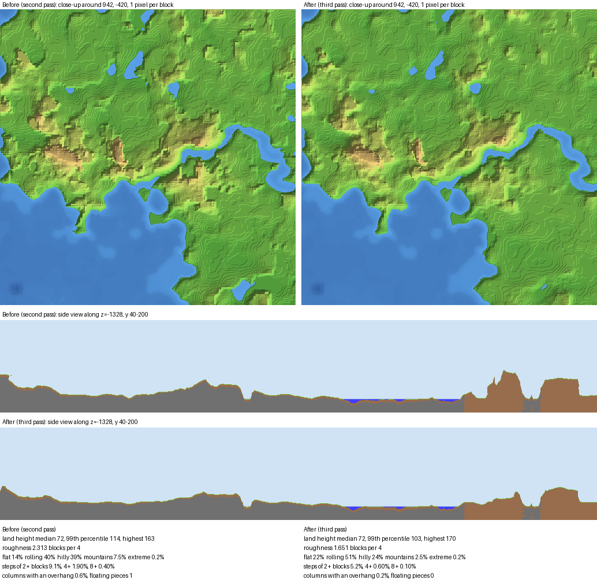

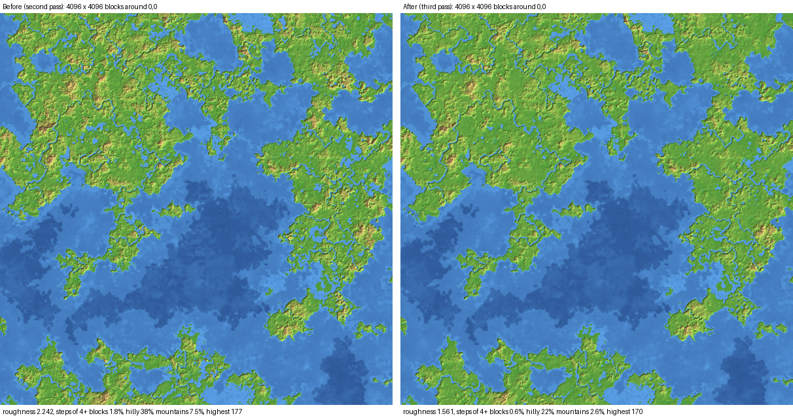

Third-pass variants, on the land-rich 2048 x 2048 area centred on 0,-1024 (`MAP_CENTRE=0,-1024 MAP_CLOSEUP=942,-420 MAP_SLICE_Z=-1328`, the first picture above). Knobs are contrast (`scaleWeight`), base (`scaleOffset`), blending (`limitBlending`) and the plateau hills (kept or tamed); steps are the share of neighbouring land columns whose ground differs by 2, 4 or 8 blocks or more:

| Variant | Contrast, base, blending, plateaus | Roughness | Steps 2+ / 4+ / 8+ | Flat / rolling / hilly / mountains / extreme | Land: median / 99th pct / max | Overhangs | Landmasses |
|---|---|---|---|---|---|---|---|
| Beta 1.7.3 | (no biome heights) | 1.41 | 3.4 / 0.7 / 0.2% | 28 / 54 / 16 / 1.6 / 0% | 71 / 101 / 122 | 0.4% | 86 |
| Release 1.6.4 | 1, 0, 10, plateaus | 1.27 | 4.1 / 0.8 / 0.2% | 46 / 36 / 14 / 3.3 / 0% | 68 / 102 / 119 | 0.2% | 75 |
| Second pass | 0.45, 0.85, 10, plateaus | 2.31 | 9.1 / 1.9 / 0.4% | 14 / 40 / 39 / 7.5 / 0.2% | 72 / 114 / 163 | 0.6% | 31 |
| Lower base | 0.45, 0.45, 10, plateaus | 1.59 | 5.1 / 0.7 / 0.1% | 24 / 54 / 20 / 1.9 / 0% | 72 / 101 / 132 | 0.2% | 23 |
| Lower base, more contrast | 0.75, 0.4, 10, plateaus | 1.78 | 6.2 / 1.0 / 0.2% | 21 / 50 / 25 / 3.9 / 0.2% | 72 / 107 / 163 | 0.3% | 24 |
| Plateaus tamed | 0.6, 0.45, 10, tamed | 1.71 | 5.6 / 0.8 / 0.2% | 20 / 53 / 24 / 2.4 / 0.1% | 72 / 101 / 149 | 0.4% | 25 |
| Gentler vertical noise | 0.6, 0.6, 10, tamed; `noise_scale.height` 400 | 1.83 | 6.8 / 1.4 / 0.3% | 18 / 52 / 28 / 1.9 / 0% | 72 / 101 / 135 | 0.5% | 26 |
| Blending 40, low base | 0.6, 0.45, 40, tamed | 1.48 | 4.3 / 0.4 / 0.1% | 25 / 54 / 19 / 1.7 / 0% | 72 / 99 / 142 | 0.1% | 26 |
| Blending 40 | 0.6, 0.6, 40, tamed | 1.72 | 5.6 / 0.6 / 0.1% | 20 / 50 / 27 / 2.8 / 0.1% | 72 / 103 / 156 | 0.3% | 29 |
| Blending 80 | 0.6, 0.65, 80, tamed | 1.49 | 4.4 / 0.4 / 0.0% | 26 / 51 / 22 / 1.9 / 0% | 72 / 101 / 142 | 0.1% | 22 |
| Shallower rivers | 0.7, 0.5, 40, tamed; rivers `-0.35;0.0` | 1.65 | 5.1 / 0.6 / 0.1% | 22 / 52 / 24 / 2.5 / 0.2% | 72 / 103 / 170 | 0.2% | 20 |
| **Third pass (shipped)** | 0.7, 0.5, 40, tamed | 1.65 | 5.2 / 0.6 / 0.1% | 22 / 51 / 24 / 2.5 / 0.2% | 72 / 103 / 170 | 0.2% | 26 |

Lowering the base does most of the smoothing; the blending removes most of what is left of the walls and floating rock; the contrast decides how much the extreme hills keep. A gentler vertical noise (Moderner Beta's `noise_scale.height`, 684.412; 400 and 250 tried) did the opposite of what was hoped: it took the overhangs away but made the slopes steeper. Even more blending (80) or a lower base (0.45) come closest to Beta's numbers but leave almost no overhangs and flatter extreme hills; the shipped mix keeps a few of both.

For more drama, the "Blending 40" row (base 0.6, contrast 0.6) keeps more hills and overhangs; the second pass's numbers (contrast 0.45, base 0.85, blending 10, no `height_overrides`) bring back its rougher land.

The Eternal Return baselines were recorded again for the new terrain: the old-caves carving fingerprint (25 of its 27 chunks changed) and the ore census, where coal fell from 19,174 to 17,470 ores (less high ground for coal's upper veins, mostly in ice plains, forests and birch forests) and gold from 4,645 to 4,579 (the badlands' extra gold runs from y 32 up, and badlands hills are lower now); every other ore stayed within 0.5 percent. The control worlds (vanilla, Moderner Beta's 1.6.4, 1.6.4 amplified and Beta 1.7.3) still match their fingerprints, and their maps came out pixel for pixel the same.

**Second pass (superseded, after playtesting the first).** The first pass (below) gave mountains up to y 307, 200-block spires and many floating islands, and the change from plain to spire was sudden. That came from multiplying each biome's own height range by 2.5: extreme hills, hills variants and mushroom islands became far more rugged than deserts (median relief 64 blocks against 12 on the land-rich test area). The second pass cuts that multiplier to 0.45 and adds a fixed 0.85 to every land biome instead, so every biome gets a similar Beta-style roll and the hilly biomes are only somewhat hillier (median relief 10 to 27 blocks by biome; Beta 9 to 15). The land lift is roughly halved too.

Swamps stay flat (median relief 2): they sit below the "land only" cut-off, as in 1.6.4.

The knobs, most important first (Moderner Beta's names in brackets):

| Knob | Shipped (third pass; second pass; 1.6.4) | What it does |
|---|---|---|
| One land height (`forced_biome_height.heightOverrides` for every land biome, knob `land_height`) | `0.1;0.05` (each biome its own) | Gives every land biome and its variants the same depth and scale, so the biome has no say in the land's shape. `land_height_except` lists biomes that keep their own. |
| Sampled scale noise (`noise_landmass.scale`: `sample`, `influence`, `offset`, `variation`) | on, 1.0, 0.22, 1.121 (off; off; off) | Beta's slow ruggedness noise: flat, rolling and hilly country in stretches a kilometre or two across. Influence widens the gap between calm and wild country, the offset lifts all of it. |
| Water scale (scale of every ocean and river height, knob `water_scale`) | -1.2 (0.2 oceans, 0 rivers, as 1.6.4) | Cancels the scale noise over water, which would otherwise raise islets out of the sea and bars across rivers. Their depth stays. |
| Boost land only (`forced_biome_height.modifyOnlyPositiveDepth`) | true (true; true; false) | The boosts below apply to land biomes only. Ocean floors keep their 1.6.4 depth, which is what keeps 1.6.4's coastlines and ocean sizes. |
| Biome contrast (`scaleWeight`) | 1 (0.7; 0.45; 1) | Multiplied each biome's own ruggedness; with one land height it only scales that. |
| Base ruggedness (`scaleOffset`) | 0 (0.5; 0.85; 0) | Added ruggedness to every land biome; the scale noise's offset does that job now. Around 0.85 the land was bumpy and ledged everywhere. |
| Noise blending (`noise_scale.limitBlending`, knob `limit_blending`) | 40 (40; 10; 10) | How wide the band is where the terrain's two 3D noises blend into each other. Narrow (Beta's and 1.6.4's 10) makes sudden walls and ledges where the two disagree; 40 smooths most of them away; 80 leaves almost no overhangs. Applies to ocean floors too. |
| Plateau hills (knob `height_overrides`) | none (jungle and savanna hills `0.6;0.8`, badlands hills `0.8;0.5`; none; jungle hills `1.8;0.5`) | The third pass's fix for hills variants with a plateau height; one land height covers them now. |
| Land height (`depthWeight`, `depthOffset`) | 1.2, 0.2 (1.2, 0.2; 1.2, 0.2; 1, 0) | How high land sits above the sea. Land sits around y 70. |
| Terrain ceiling (noise settings height) | 320 (320; 320; 128) | Where terrain has to stop. Not reached any more, but leaves room. |
| Depth noise strength (`noise_landmass.depth.influence`) | 0.2 (0.2; 0.2; 0.2) | Beta's 1.0 breaks the coastline into islets; 0.35 made little difference. |
| Vertical stretch (`noise_scale.stretchY`) | 12 (12; 12; 12) | Lower values (9) give taller, thinner spikes. |
| Vertical noise scale (`noise_scale.height`) | 684.412 (not a knob) | 400 or 250 take overhangs away but make slopes steeper (third pass, tried and dropped). |
| Bottom slide (`noise_slide.bottomSize`, knob `bottom_slide_size`) | 1 (3; 3; 3) | How far above bedrock the terrain is forced solid, in 8-block steps. Lowered so sinkholes reach y -55 and below (see Terrain features). |
| Aquifers (noise settings `aquifers_enabled`, knob `aquifers`) | false (true; true; true) | Off so deep water is one body of sea water, without stone walls between pockets (see Terrain features). |
| Old growth taigas (knob `old_growth_taiga_chance`) | 2 (none) | One in this many taiga patches with taiga all around becomes old growth pine or spruce taiga. |

Second-pass variants, on the 2048 x 2048 area centred on 0,-1024 (the land-rich part of the map; `MAP_CENTRE=0,-1024 MAP_CLOSEUP=942,-420 MAP_SLICE_Z=-1328`). Contrast is `scaleWeight`, base is `scaleOffset`, lift is `depthWeight` / `depthOffset`:

| Variant | Contrast, base, lift | Land: median / 99th pct / max | Flat / rolling / hilly / mountains / extreme | Overhangs | Relief: extreme hills vs desert |
|---|---|---|---|---|---|
| Beta 1.7.3 | (no biome heights) | 71 / 101 / 122 | 28 / 54 / 16 / 2 / 0% | 0.9% | 9-15 in every biome |
| First pass | 2.5, 0.6, 1.6 / 0.5 | 78 / 202 / 307 | 7 / 23 / 36 / 24 / 10% | 6.8% | 64 vs 12 |
| Even | 0.86, 0.98, 1.3 / 0.25 | 73 / 137 / 207 | 11 / 28 / 40 / 19 / 2% | 4.1% | 34 vs 13 |
| Even, lower | 0.8, 0.8, 1.3 / 0.25 | 72 / 125 / 202 | 14 / 34 / 38 / 12 / 1% | 1.9% | 30 vs 10 |
| Flatter contrast | 0.6, 0.9, 1.3 / 0.25 | 72 / 123 / 171 | 14 / 34 / 39 / 13 / 1% | 2.6% | 29 vs 11 |
| Even more | 0.45, 1.0, 1.3 / 0.25 | 72 / 123 / 175 | 13 / 33 / 40 / 14 / 0% | 3.0% | 28 vs 12 |
| Tame | 0.7, 0.7, 1.2 / 0.2 | 72 / 115 / 153 | 17 / 41 / 34 / 9 / 0% | 1.0% | 28 vs 9 |
| **Even more, tame (shipped)** | 0.45, 0.85, 1.2 / 0.2 | 72 / 115 / 162 | 15 / 39 / 37 / 9 / 0% | 1.0% | 26 vs 10 |

Also tried on the area centred on 0,0: Beta's sampled scale noise on top of "even" (influence 0.4) gave about the same land but 123 landmasses instead of 44 (islets across the oceans), and depth noise 0.35 changed almost nothing.

For a little more drama, the "even more" numbers (`depth_weight` 1.3, `depth_offset` 0.25, `height_scale_offset` 1.0) keep the same evenness with more cliffs and some floating rock.

**First pass (superseded).** Same goal, judged on the maps alone. Variants on the 2048 x 2048 area centred on 0,0:

| Variant | Change from 1.6.4 | Land height: median / 99th pct / max | Roughness | Overhangs | Landmasses | Verdict then |
|---|---|---|---|---|---|---|
| Beta noise on 1.6.4 | sampled scale on, no land boost | 70 / 119 / 202 | 2.2 | 0.5% | 171 | islets everywhere, little drama |
| Mild boost | land only; height 1.5 / 0.3, scale 2.0 / 0.4 | 72 / 203 / 253 | 3.0 | 5.1% | 36 | good but tame |
| Mild boost + Beta noise | as above, sampled scale 0.4 | 72 / 205 / 269 | 3.3 | 7.8% | 122 | more islets, same drama |
| First pass | land only; height 1.6 / 0.5, scale 2.5 / 0.6 | 76 / 227 / 307 | 4.0 | 8.6% | 33 | chosen; too extreme in game |
| First pass + Beta noise | sampled scale 0.2 | 76 / 227 / 307 | 4.1 | 8.5% | 68 | more islets, no gain |
| First pass, stretch 9 | stretchY 9 | 76 / 273 / 311 | 5.2 | 9.9% | 94 | spikier, more islets |
| Amplified-lite | land only; height 2.0 / 0.8, scale 3.0 / 0.8 | 80 / 263 / 310 | 5.2 | 8.5% | 28 | wilder |
| Amplified | land only; height 2.0 / 1.0, scale 4.0 / 1.0 | 86 / 298 / 314 | 6.7 | 13% | 29 | mountains everywhere |

(First-pass overhang numbers came from 144 sampled chunks and are noisier than the 576-chunk numbers used now.)

### Overhang undersides

Moderner Beta works out the terrain's density only every 8 blocks of height (and every 4 across) and blends in straight lines between, as Beta and Release 1.6.4 did. Tops of hills hide that, but where rock hangs over open air the underside lands between two of those 8-block steps and comes out as a near-flat plane, often 10 to 20 blocks across: on the test seed, over squares of 8 x 8 chunks in seven biomes, 36 percent of the overhang undersides you can see from outside lay in flat patches of 12 columns or more at one height, the biggest 94 columns (a jungle overhang near 965, 100, 295). A finer step isn't an option: Moderner Beta's 1.6.4 terrain counts height in those steps, so halving them would double the height of every hill.

So `OverhangRounder` (`com.eternalreturn.worldgen.terrain`) reshapes them. In Eternal Return worlds, the first time the cave carver sees a chunk, before any cave is carved, it finds every place above sea level where rock sits on open air with ground (or water) below, and moves that underside following smooth 3D noise from the world seed: it arches up into the rock by 0 to 6 blocks, and where there are at least 6 blocks of air below, rock hangs lower in places (up to 3 blocks), copying the underside's own block (or, when that is grass or sand, the first block above it that isn't). It never cuts closer than 3 blocks to the top of the overhang, never leaves less than 3 blocks of air under it, never leaves sand or gravel hanging, and only touches plain open air (not water or caves). Each column is handled from its own blocks and the noise, so overhangs line up across chunk borders. Rock 3 blocks thick or less, with open air above it and at least 3 blocks of open air below, can't arch: those are floating sheets of grass and dirt, the kind plateau edges leave beside them, and since the third terrain pass the rounder removes them. A slab 4 blocks thick arches by at most a block.

After it, 11 percent of the visible undersides lay in flat patches of 12 or more, the biggest 25 columns. The third pass's terrain has far fewer overhangs, so the survey now covers squares of 16 x 16 chunks: 616 visible terrain undersides, 9 percent of them (56) in flat patches of 12 or more, the biggest 18 columns. Without the floating-sheet removal it was 27 percent (biggest 84), and the second pass's terrain over the same squares 21 percent (biggest 125). On the fourth pass's terrain: 657 visible terrain undersides, 6 percent (42) in flat patches of 12 or more, the biggest 16. The rest of the flat patches the survey finds are roofs of cave tunnels running just under the surface, which are as flat as any cave tunnel's roof.

The setting `worldgen.roundOverhangs` (on by default) turns it off. Other worlds never change. Tests: `OverhangTests` (Eternal Return run) repeats the survey and fails if more than a fifth of the visible terrain undersides lie in flat patches of 12 or more columns, or any patch passes 48, or there are 300 or fewer to judge; with the setting off it fails (311 of 976, biggest 73). The old-caves control run turns the setting off, so it still matches the world as it was before the cave engine.

### Map tool

`./gradlew generateWorldMaps` renders all three presets (about 15 minutes; add `-PworldmapHalf=1024` for a 2048-block area in a few minutes). `./gradlew runWorldmapEternalReturn` (or `runWorldmapBeta`, `runWorldmapRelease164`) renders one. Each run generates a world headlessly at seed 173164 and writes to `docs/worldgen-maps/<preset>/`:

- `height.png`: shaded height (blue water, green lowland, brown hills, grey and white mountains)
- `biomes.png`: biomes, with a legend and each biome's share
- `land.png`: land (green) against water (blue)
- `slice.png`: a side view (full height) through the row with the most high ground
- `closeup.png`: a 512-block close-up of the area with the highest ground
- `island.png`, `sinkhole.png` (Eternal Return only): a floating island and a sinkhole (see Terrain features)
- `stats.json`: the numbers in the tables above, plus each biome's median relief (`terrain_mix.median_relief_by_biome`), each biome's own flat / rolling / hilly / mountains shares (`terrain_mix.mix_by_biome`), each biome's share of ground at y 95 or higher, where Moderner Beta's emerald ore can generate (`ground_at_or_above_y95_by_biome`), and where the highest ground is (`highest_ground`, x y z). Under `weirdness`, from 576 chunks spread over the map and generated to the surface step (before caves): land columns with air under their ground (overhangs, arches, floating rock); steps between neighbouring land columns (`steps_2_or_more`, `steps_4_or_more`, `steps_8_or_more`: the share of pairs whose ground differs by that much) and the 4-block share by biome (`steps_4_or_more_by_biome`); spikes (columns at least 4 blocks above every column two blocks away, per 1,000 land columns); and floating pieces (solid ground above sea level touching neither the layer just above the sea nor the chunk's sides)

Options: `-PworldmapOut=<dir>` writes to `<dir>/<preset>/` instead; `-PworldmapCentre=x,z` moves the mapped area; `-PworldmapCloseup=x,z` and `-PworldmapSliceZ=z` pin the close-up and side view, so different settings can be compared on the same ground.

`python tools/worldgen/compare_maps.py` rebuilds `overview.png` (height and land maps with the headline numbers) and `slices_compared.png` (the three side views). `python tools/worldgen/before_after.py <before dir> <after dir> <out.png>` puts two runs of the same ground side by side (close-ups, side views and numbers; pin the close-up and side view so both show the same place); it drew `terrain_third_pass/before_after.png` and `terrain_by_noise/before_after.png`. `python tools/worldgen/shape_by_biome.py <out.png> <label>=<map dir> ...` draws each biome's mix as bars, one panel per run (`terrain_by_noise/shape_by_biome.png`). `python tools/worldgen/variants.py <variants.json>` renders a list of knob variants into `build/worldgen-variants/<name>/eternal_return/`, prints the stats for each, then restores the shipped preset; the `HALF`, `MAP_CENTRE`, `MAP_CLOSEUP` and `MAP_SLICE_Z` environment variables pass the options above.

## Terrain features

Six additions on top of the terrain passes, in Eternal Return worlds only (other worlds never change; the control runs check it). All but the old growth taigas have a setting under `worldgen` (`deepOceans`, `sinkholes`, `floatingIslands`, `monoliths`, `caveMushrooms`, all on by default); turning one off affects newly generated chunks only. One fix applies in every world: snow on trees at chunk borders (below).

### Deep oceans in steps

Like the Deeper Oceans datapack: the sea floor falls in steps the further you get from land. For about the first 50 blocks from the shore the floor sits around y 30 (sloping up to the beach over the first 25); then a steep drop to a plain around y 0; about 170 blocks out a second steep drop to the deep floor at y -30. Each drop's position wanders in and out with noise, by about 15 blocks for the first and 35 for the second, so they don't run as straight lines along the coast.

How: Moderner Beta works out each terrain column's height from the biomes around it (`getHeightConfigAt`, the "forced biome height" behind every Release-style preset). A hook there (`ModernerBetaHeightMixin`, guarded like the other Moderner Beta hooks) hands the value to `TerrainShape` (`com.eternalreturn.worldgen.terrain`), which lowers it in ocean biomes by the distance to the nearest land, and never raises it. The distance comes from the biome map Moderner Beta already has, worked out per region and cached. The ocean type (deep, warm, cold and so on) no longer decides the depth; it still decides the ocean's ruins, temperature and fish. Coastlines and islands stay where they were: the water share and every land number on the map are unchanged (57.2 percent water), but half the water is now 57 blocks deep or more instead of 15 (90th percentile 91 instead of 29).

On the test seed, sampling the sea floor every 32 blocks over 8,000 x 8,000 blocks, the floor sits in three bands: y 30 to 59 (the shelf and its slope to the beach) 26 percent of samples, y -10 to 9 32 percent, y -40 to -21 38 percent, and only 4 percent in between (the drops themselves). The deepest floor is y -35. Near spawn: x 32, z 0 is on the shelf at y 30, x 64, z 0 on the middle step at y 0, and x -32, z 224 on the deep floor at y -31.

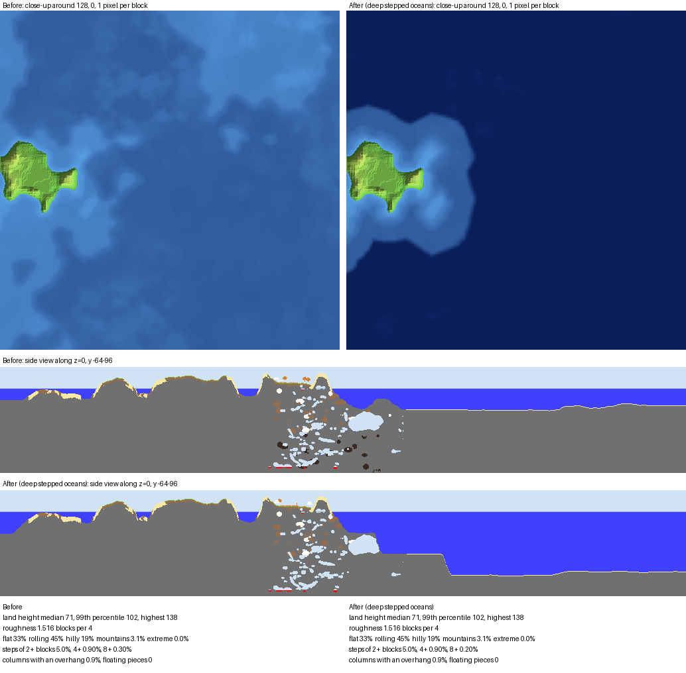

### Sinkholes

Release 1.19.2 sometimes opened huge pits where the terrain noise went wild. Here they are a planned rarity, mostly in the sea: the world is split into squares of 1,024 blocks, and about a third of the squares holds a sinkhole, 84 to 116 blocks across, placed from the world seed alone. One whose centre lies in the sea is always made; one on land only one time in five (`TerrainShape.SINKHOLE_LAND_CHANCE`), and never on a river or beach. A sinkhole is a round pit with a ragged edge and near-sheer walls, from the sea floor (or the land) straight down to about y -55 to -63, full of water up to sea level: a dark blue hole that drops to the bottom of the world. The terrain test (`sinkholesReachTheBottom`) lists the test seed's sinkholes within 8,192 blocks of spawn and checks that most are in the sea and that each reaches the bottom.

How: the same hook as the deep oceans gives the columns inside the pit a very low height and little ruggedness. Two preset changes were needed to let the pit reach the bottom and fill cleanly (`tools/worldgen/knobs.json`):
- `bottom_slide_size` 1 (Moderner Beta's `noise_slide.bottomSize`, 3 before): the slide that keeps the bottom of the world solid started 24 blocks above bedrock and stopped the pits near y -30. Now it starts 8 blocks up. Nothing else changes: no other ground comes that low.
- `aquifers` false (the noise settings' `aquifers_enabled`): with aquifers on, the game splits deep water into separate pockets with stone walls between them, so a pit came out with stone ledges and air pockets halfway down. With them off, all water below the surface is sea water, up to sea level. Nothing else in the world relied on them: the cave engine picks its own air, water and lava, and the old caves (`worldgen.caves.oldCaves`) get a fill of their own (`OldCaveFluids`, through `ConfiguredCarverMixin`): air, and water below sea level only in columns with water over their ground. Without that, every old cave below sea level filled with water. (On the cave map's square the old caves are 0.56 percent open, 0.57 before; without the fill, 0.12.) Caves stay out of the sea, so under the deeper sea floor there is less room for them: the cave map's gallery squares, around x 5,000, z 5,000, lie under the sea and hold fewer of their forced caves (vertical shafts 4.5 to 1.6 percent open, zig-zags 2.4 to 1.0), while the cave share on land is unchanged (5.42 percent).

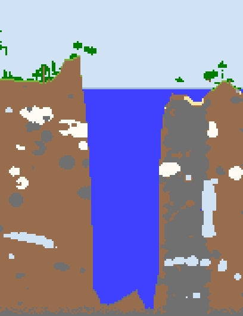

### Floating islands

Rare islands high in the sky, alone or in clusters. The world is split into squares of 1,024 blocks, and 7 in 10 squares hold a group of islands, placed from the world seed alone, so every chunk an island touches builds its own part and the parts line up in whatever order chunks generate. Half the groups are a single island, 16 to 300 blocks long, the big ones rarer (half are under about 80 blocks); the other half are clusters: a main island up to 160 blocks across with two to six smaller ones round it, each at its own height, up to 40 blocks above or below the main one. An island is an oval, round to twice as long as it is wide, lying any way, with a ragged edge (big bays and points, and smaller ones along them on a big island). Its top, between y 195 and y 290, is a little domed, more so the bigger it is, with low hills on the big ones. Its underside narrows to a point 8 to 85 blocks below the top (the wider the island, the deeper), never lower than y 165, above the highest ground (about y 145).

Each island is made of the ground straight below it: the top six blocks of that column (grass and dirt, sand and sandstone, the badlands' terracotta, snow) and the biome's stone under them, so a desert island is sand over sandstone and an autumnal forest island grass over andesite. The biome's trees, plants and snow then come with the chunk's decoration, as on the ground. Over the sea an island is a sandy one: sand over sandstone over stone. Nothing loose sits at the bottom, where it would fall.

How: `FloatingIslands` builds them when the cave carver first sees a chunk, right after the overhang rounder (which would otherwise trim them as floating rock); caves start far below them. On the test seed, 50 islands within 2,048 blocks of spawn (x, top, z): a taiga island 176 by 142 blocks at -1731 273 -466, a forest island 132 by 90 at 299 221 -1293, a sandy one over the ocean 122 by 78 at -526 290 359, a badlands island at -307 262 -1358, a cherry grove cluster round 1397 232 -1364, and a cluster of six small ice plains islands from y 215 to 277 round -372 -400. The picture below is of an island from before islands came in clusters and ovals (the map tool redraws it).

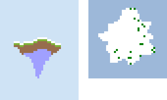

### Monoliths

Alpha now and then threw up monoliths: sheer-sided blocks of land standing from the ground into the sky. Here they are a planned, extreme rarity: the world is split into squares of 10,000 blocks, each holding one monolith, placed from the world seed alone. A monolith is a box with rounded corners and slightly ragged walls, 20 to 50 blocks wide and up to two and a half times as long, lying north-south or east-west, standing from the ground (or the sea floor, through the water) to a flat top between y 190 and y 250 that steps down a block or two at its rim. Like a floating island it is made of the ground it stands on: the top five blocks of topsoil and the biome's stone under them (sand over the sea), so the biome's trees, grass and snow grow on top with the chunk's decoration.

How: `Monoliths` (`com.eternalreturn.worldgen.terrain`) builds each chunk's part when the cave carver first sees the chunk, right after the floating islands. The test `monolithsRiseToTheSky` takes the nearest of the four squares around spawn, generates its middle and checks rock for 60 blocks under its top (y 188 or higher), nothing solid above and open air beside it.

### Mushrooms in caves

As before 1.18, brown and red mushrooms grow on cave floors: up to six tries a chunk for a brown patch and three for a red one, each at a random height between 8 blocks above the bottom and y 56, taken only where it lands in a cave (air) and dropped to the floor below; a patch is up to two dozen tries around that spot. Two placed features (`data/eternalreturn/worldgen/placed_feature/cave_brown_mushroom.json`, `cave_red_mushroom.json`), added last to every overworld biome's plants and carrying `eternalreturn:eternal_return_only`, so nothing else in the decoration order moves and other worlds don't change. The test `mushroomsGrowInCaves` counts them in the 8 x 8 chunks around spawn.

### Snow on trees at chunk borders

Every world (`worldgen.snowOnBorderTrees`): MC-119599, as the Simple Snowy Fix mod fixes it. A chunk is snowed on (vanilla's `freeze_top_layer`, the last step of its decoration) before the trees of the chunks around it grow, so a tree reaching over from a neighbour stood on snowy ground with bare leaves. Now, after each tree grows during generation (not from a sapling), every column it may cover that was already snowed on gets what vanilla gives a tree within one chunk: snow on its top leaves, and no snow (nor snowy grass) on the ground under them (`SnowyTrees`, `TreeSnowMixin`). Columns not yet snowed on are left to vanilla, which does the same in its turn. This changes snowy forests in every world; the vanilla world's fingerprinted chunks hold no such tree, so its decoration baseline still matches.

### Old growth taigas

Old growth pine taiga and old growth spruce taiga (vanilla's, with their giant spruces, podzol and coarse dirt) turn up as patches inside taigas. The biome layers decide once, for each taiga patch with taiga on all four sides, whether it becomes old growth (`old_growth_taiga_chance` 2 in the knobs: one in two), and if so, pine or spruce evenly. They stay rare: each about 0.1 percent of the map, eight patches in the 4,096 x 4,096 test map (pine near -136, -2000, 520, -1984 and -964, -1920; spruce near -720, -248, 1300, 188 and -200, -2032). They take the shared land height like every land biome, and andesite for their stone, like the taiga around them.

### Tests

`TerrainFeatureTests` (batch `terrain_features`, part of the Eternal Return run):
- `oceansFallInSteps`: samples the sea floor every 32 blocks over 8,000 x 8,000 blocks; fails unless the deepest floor is between y -40 and -24, at least a third of the samples sit on the deep floor, the floor sits near one of the three steps more than three times as often as between them, and there are steep drops (10 blocks or more over 4).
- `sinkholesReachTheBottom`: every sinkhole on land within 8,192 blocks must reach y -25 or lower and three quarters of them y -45; the nearest is generated and checked block by block: water from its floor to sea level, no stone ledges.
- `floatingIslandsMatchTheGroundBelow`: at least 10 islands within 2,048 blocks; the nearest four are generated and checked: top at y 195 or higher, rock at the point, the point at y 165 or higher, 6 blocks or more below the top (no more than 24 past its planned depth) and below the island's sides (pointed, not flat), and a top block that matches the ground below (or sand over the sea).

`EternalReturnPresetTests` and `BiomeStoneTests` know the two old growth taigas (andesite). The preset test's "solid rock below y 0" check now counts only below the sea floor, since spawn can sit over a sea floor at y -30.

The Eternal Return baselines were recorded again, once for this batch and the gem and bonus-ore batch together. The old-caves carving fingerprint changed in 24 of its 27 chunks: the deeper sea floors and the lower bottom slide. The ore census moved almost only from the bonus ores: badlands gold 981 to 1,893, jungle coal 1,630 to 3,762, desert lapis 310 to 509, ice plains diamond 425 to 527, taiga iron 1,322 to 1,462, extreme hills emeralds 0 to 18 (emerald survey 442 to 671); every other ore moved by 1 to 3 blocks, spots the new gem ores took first. Every control world still matches its fingerprints. Two tests needed updating: the forced-type cave tests (`CaveTests`) measured squares at chunk 3000, 3000 and east, which now lie over the deep sea floor with too little rock above the lava level for a spiral or toroidal room, so each test now takes the first square from there northward that is all land (and the spiral and toroidal shape checks skip a cave whose footprint overlaps another's, since on land, at the forced rate, neighbours cut through each other's middle); and the old-caves run's "no block of this mod" check now allows this mod's own features in Eternal Return worlds (ruby and sapphire ore, azalea trees), still failing on any ore variant or hardened block.

The map tool draws `island.png` and `sinkhole.png` (Eternal Return only): the nearest island at least 28 blocks across over land (side view and from above), and the nearest sinkhole at least 36 blocks across that reaches y -30 (side view).

## Clutter (expansion phase 1)

Small objects on the ground, each biome its own, in Eternal Return worlds only (other worlds never change; the flat runs check the feature places nothing there). So far boulders; later phases add more kinds through the same pieces.

**Boulders.** Lumps of rock half sunk in the ground of most land biomes, made of the ground's stone where that is stone, granite, diorite or andesite, and of plain stone elsewhere (so grey stone on the ice plains). The owner's call after the first look: boulders are only ever those four stones, and the desert, swampland, autumnal forest and badlands have none. How many per chunk is set per biome in `data/eternalreturn/worldgen/placed_feature/boulder.json`, which can be tuned without touching code:

| Biome | Boulders per chunk |
|---|---|
| extreme hills | 1.5 |
| old growth pine and spruce taiga | 1.0 |
| taiga | 0.8 |
| savanna | 0.6 |
| forest, birch forest | 0.5 |
| cherry grove, ice plains (and snowy plains) | 0.4 |
| dark forest, jungle | 0.3 |
| plains | 0.25 |
| mushroom fields | 0.1 |
| desert, swampland, autumnal forest, badlands | none |
| any other land biome (`default`) | 0.3 |
| oceans, rivers, beaches (`#minecraft:is_ocean`, `is_river`, `is_beach`) | none |

The placement `eternalreturn:biome_density` makes `max_per_chunk` (4) tries at random columns of the chunk and keeps each with chance density / `max_per_chunk`, using the biome on that column's surface, so a chunk across a border gets each side's share. In `density`, a key is a biome id or a biome tag written `#namespace:path`; an id wins over a tag, tags are tried in the order written, and ids and tags of mods that aren't installed never match. Any biome in none takes `default`.

**Templates.** The feature `eternalreturn:boulder` (`configured_feature/boulder.json`) places one structure template from the folder `eternalreturn:boulder` (`data/eternalreturn/structure/boulder/`), picked at random, turned to one of four directions and mirrored half the time. It is centred on the spot, set on the lowest ground under its footprint, and sunk 1 block (`sink`; at 2, the flat shape disappeared into the ground). Nothing is placed if any column under it is water or not solid ground, or the ground under it differs by more than 4 blocks (`max_slope`). (The first version checked only the four corners and the middle, and the in-game check found a boulder standing in a small pool.) The five starter shapes come from `tools/clutter/build_boulders.py` (lumps of one to three overlapping ellipsoids with a ragged surface, from fixed seeds):

| Template | Blocks | Size (x by y by z) |
|---|---|---|
| small | 16 | 3 x 3 x 3 |
| round | 48 | 5 x 4 x 5 |
| flat | 41 | 6 x 2 x 4 |
| standing | 34 | 3 x 5 x 3 |
| pair | 50 | 7 x 4 x 4 |

Any other template saved into that folder (with a structure block in game, then copied into `data/eternalreturn/structure/boulder/`, or in a datapack) is placed alongside them. Build it from plain stone and save it without air (structure void round it), so it doesn't cut into the ground; the list is read once per server start.

**Stone.** The processor `eternalreturn:biome_stone` (`BiomeStoneProcessor`) turns a template's plain stone into the stone of the ground it stands on: the first stone or host stone (block tag `eternalreturn:biome_host_stones`) straight down from the middle of the boulder's footprint. So a boulder is all one stone and matches the rock beneath it, even on a biome border, where the ground's stone wanders a block or two from column to column (Moderner Beta's per-block biome, which the F3 biome doesn't always agree with; the first version used the F3 biome and got about one boulder block in six on a border wrong). Where no stone lies within 32 blocks below, it takes the biome's: each host stone's biomes are the biome tag `eternalreturn:biome_stone/<block path>` (`andesite`, `diorite`, `granite`, `hardened_sandstone`, `red_sandstone`, `hardened_packed_ice`), written by `build_preset.py` from the table in the knobs. The feature's `stones` (block tag `eternalreturn:boulder_stones`: stone, granite, diorite, andesite) limits what a boulder may become: over any other ground stone (hardened sandstone, red sandstone, hardened packed ice) it stays plain stone. With `worldgen.biomeStone` off the ground is plain stone, and so are the boulders. Later phases (ruins, landmarks) can use the same processor.

**Timing.** Boulders are in every overworld biome's feature list, last of the underground decoration step, so no other feature's place in the decoration order moves. That is after the lakes, the ores and the dirt, gravel and stone blobs, and before the trees, plants and snow, so trees and grass grow round them and snow settles on them. The first version placed them with vanilla's forest rocks (local modifications), before the ores, and the in-game check found a plains boulder with dirt patches and coal ore in it. `worldgen.boulders` (on by default) takes them out of the lists (next start, newly generated chunks).

Checked in game (a new Eternal Return world on the test seed, one boulder looked at in each of forest, birch forest, autumnal forest, desert border, badlands, taiga, ice plains, savanna and plains, before the owner limited the stones and biomes): diorite in the birch forest, granite in the savanna, plain stone in the plains; grass and trees round them.

### Tests

`ClutterTests`:
- `bouldersStandOnTheLand` (batch `clutter`, Eternal Return run): around up to eight land spots on the test seed (from a grid every 512 blocks out to 1,536), 5 x 5 chunks each generated in full. A boulder block is stone or a host stone straight on topsoil (grass, sand, red sand, podzol, mycelium, coarse dirt, snow block), which the terrain never makes on its own. Boulders are those blocks grouped by touching (same stone). Fails if any boulder is not a boulder stone, or unless boulders are in at least a fifth of the land chunks whose biome gets them (density above 0 in the middle of the chunk), and nine boulders in ten are the ground's own stone somewhere under them (plain stone over ground that isn't a boulder stone). On the test seed: 8 land spots, 146 land chunks of boulder biomes, boulders seen in 35 of them, 50 boulders (34 stone, most of them on the ice plains, 10 andesite, 3 diorite, 3 granite), all 50 on their own stone. Boulders whose upper layers sit only on their own lowest layer aren't seen, so the count is a floor.
- `noBouldersInOtherWorlds` (batch `clutter_other_worlds`, flat runs): the boulder placed feature places nothing in a world that isn't Eternal Return.

## Biome trees (expansion phase 2)

In Eternal Return worlds a sapling grows a tree picked from the table of the biome it is planted in, by bone meal or on its own, and the trees the world generates with come from the same tables, so the trees found in a biome are the ones its saplings grow into. A player learns it by planting: the same oak sapling grows a bald cypress or a willow in the swampland and a scrub oak in the savanna. Other worlds keep vanilla's saplings and trees (the owner's call), and so does any biome or sapling without a list. Setting `worldgen.biomeTrees` (on).

**Species.** Every wood that grows in Eternal Return worlds has new shapes, each after a real tree, built by `tools/trees/build_trees.py` from vanilla's trunk and foliage placers (`worldgen/configured_feature/tree/`), plus two templates no placer can make (`structure/tree/`):

| Wood | Species |
|---|---|
| oak | white oak (great spreading crown), bur oak (short trunk, wide low crown), bald cypress (tall, narrow, hung with vines), scrub oak (low, crooked, as wide as tall; its crown closes over the trunk), shrub oak (knee-high thicket), weeping willow (template: dome with hanging curtains) |
| spruce | larch and young larch (templates: open tiers of short level branches with bare trunk between, drooping tips, a thin spire), grand fir (tall broad cone), black spruce (thin dense spire), pinyon pine (short, crooked, round bushy crown; phase 6), Utah juniper (low, many-stemmed, shrubby; phase 6), coast redwood (mega: colossal bare trunk, small crown far up) |
| birch | Lombardy poplar (tall narrow column), dwarf birch (knee-high tundra shrub; phase 6), silver birch (hanging twigs), river birch (two or three leaning stems) |
| jungle | kapok (mega: emergent, flat crown above the canopy), teak (tall clean trunk, cocoa) |
| palm (jungle wood, templates) | coconut palm (tall, straight), leaning palm (slanting steadily), curved palm (upright, bending over toward the top), tall palm (very tall, two kinks), dwarf palm (short, full crown), twin palm (two trunks from one foot) |
| mangrove | red mangrove (high on arching stilt roots), black mangrove (low, many branches, wide flat crown), dwarf mangrove (knee-high, bushy); vanilla's roots, hanging propagules and vines |
| acacia | umbrella thorn (wide flat crown), whistling thorn (low bush), baobab (template: fat bottle trunk, short branches) |
| dark oak | ancient dark oak (mega: taller, heavier), hornbeam (a single dark oak sapling grows it, anywhere) |
| cherry | weeping cherry (long curtains of blossom), mountain cherry (small, upright) |
| maple | sugar maple (big round crown), Japanese maple (low, wide, airy) |
| pale oak | aspen (slim, narrow crown), spreading pale oak (broad, branching); each in red, orange or yellow at random, like the pale oak sapling's own tree |
| azalea | tall azalea, azalea shrub (from a bone-mealed azalea bush, anywhere) |

Mega trees grow from four saplings in a square, as vanilla's big spruces do.

**Not placed yet (owner's call, 2026-11-01).** Pale oak no longer grows in the autumnal forest, which is maple only now (`tools/woods/build_woods.py`); its shapes, the mangroves and the palms outside the jungle get their biomes with the new biomes of phase 6 (islands, archipelagos, tropical biomes). Until then a pale oak sapling grows vanilla's pale oak anywhere, a mangrove propagule vanilla's mangrove, and palms grow only in the jungle. A sapling only ever grows a tree of its own wood (also the owner's call), so when a biome later grows trees of another wood those will be worldgen-only.

**Palms.** Templates from `palm()` in the script: a trunk path (straight, slanting, curving, kinked or forked), a knob of log stubs on top (two out in the main directions, one on the diagonals: the frond bases, which carry the leaves so none is more than 6 from a log), a small tuft, and eight separate fronds, the main ones rising a step and then falling away in steps to 3 below the knob, the diagonal ones shorter, with sky between them. A first try with a solid dome over the knob looked like an umbrella; the open crown follows the owner's reference picture. The jungle grows them for now; their real homes (beaches, islands) come with phase 6.

**Larch.** The placer larch was too like the black spruce (owner), so it is a template now: tiers of short level branches every 2 or 3 blocks with bare trunk between, needles in loose tufts along them, drooping tips, shrinking to a thin spire.

**Tables.** `data/eternalreturn/eternalreturn/tree_tables/*.json`, hand-written (tune freely). Each names its `biomes` (ids, `#tags`, or `"*"` for any) and, per sapling block, `trees` (one sapling) and `mega_trees` (four in a square), each a weighted list of entries: `{"weight": 3, "tree": "vanilla"}` (what vanilla would grow, fancy oaks and bee nests included), `{"weight": 2, "tree": "<configured feature>"}`, or `{"weight": 1, "template": "<structure template>"}`. For a biome, a table naming it by id wins over one naming a tag, which wins over `"*"`; among those, the first by file name with a list for that sapling. `sapling_trunks.json` maps each sapling to its log, so a generated tree's trunk tells which sapling's list to use. Four saplings in a square use the biome's mega list, or grow as vanilla if it has none; a single sapling uses the one-sapling list.

| Table | Biomes | Lists (weights; v = vanilla) |
|---|---|---|
| forest | forest | oak: v 6, white oak 2, bur oak 2; birch: v 4, silver birch 2, river birch 1, poplar 1 |
| birch_forest | birch forest | birch: v 4, poplar 3, silver birch 2, river birch 1; oak: v 3, white oak 1 |
| plains | plains | oak: v 3, bur oak 3, white oak 1; birch: v 2, poplar 2 |
| taiga | taiga | spruce: v 5, larch 2, young larch 1, grand fir 2, black spruce 2; mega: v 2, redwood 1 |
| old_growth_taiga | old growth pine and spruce taiga | spruce: v 3, grand fir 2, larch 1, young larch 1; mega: v 2, redwood 2 |
| extreme_hills | extreme hills | oak: v 4, scrub oak 3, bur oak 1; spruce: v 2, black spruce 1, larch 1, young larch 1 |
| ice_plains | ice plains, snowy plains | oak: v 3, shrub oak 2, scrub oak 1; spruce: v 1, black spruce 3; birch: v 1, river birch 2 |
| swampland | swampland | oak: v 3, bald cypress 3, willow 2 |
| savanna | savanna | acacia: v 3, umbrella thorn 3, baobab 1, whistling thorn 2; oak: v 2, scrub oak 2, shrub oak 1 |
| jungle | jungle | jungle: v 12, teak 6, each palm 1 (coconut, leaning, curved, tall, dwarf, twin); mega: v 3, kapok 2; oak: v 2, white oak 1 |
| dark_forest | dark forest | dark oak mega: v 3, ancient dark oak 2; birch: v 2, river birch 1; oak: v 3, white oak 1 |
| cherry_grove | cherry grove | cherry: v 3, weeping cherry 2, mountain cherry 2 |
| autumnal_forest | autumnal forest | maple: v 3, sugar maple 2, Japanese maple 2 |
| everywhere | `*` | azalea and flowering azalea: v 2, tall azalea 2, azalea shrub 1; dark oak (one sapling): hornbeam |

**Worldgen.** As an Eternal Return chunk decorates, each tree a biome's features place (`TreeFeatureBiomeMixin`) is looked up by its trunk: oak logs use the oak sapling's list, a giant, mega jungle or dark oak trunk the mega list. The pick uses the chunk's own random numbers, so a world comes out the same each time it generates. Bushes (bush foliage, such as the jungle bushes) are left alone, and a tree a table picked is never looked up again. On the test seed, around 8 land spots: taiga 140 vanilla spruces, 66 grand firs, 63 larches, 42 black spruces; forest 298 vanilla, 90 bur oaks, 86 white oaks, 36 silver birches, 15 river birches, 10 poplars; old growth spruce taiga 37 vanilla, 14 grand firs, 13 redwoods, 8 larches; autumnal forest 64 vanilla, 33 sugar maples, 31 Japanese maples, 31 aspens, 15 spreading pale oaks (counted before the autumnal forest became maple only); dark forest 192 vanilla, 70 ancient dark oaks.

**Templates.** A template tree's trunk is the middle of its bottom layer and lands on the sapling, whatever the turn and mirror (the game mirrors a template across its corner, so the placement shifts it back). It grows only if it fits, like a sapling's own tree: dirt or grass under the trunk, and every spot it fills air, leaves or a plant a tree may replace (only the spots it fills: a leaning palm's box is 21 blocks wide). Its leaves are then set as a tree's own (not persistent, each at its true distance from a log), so a cut template tree's leaves decay as vanilla's do; logs keep their direction when turned. The script checks every template leaf is within 6 blocks of a log. Hand-built templates (structure blocks) can be named in a table too.

**Leaves that would drop.** With random tick speed at 1000 the owner saw leaves dropping off new trees: in ten species some leaves were 7 to 9 blocks from a log (kapok 97 of 1,402 over six trees, hornbeam 63, sugar maple 57, umbrella thorn 44, white oak 32, grand fir 24, river birch 17, and the crowns below), and the scattered crowns (Japanese maple, tall azalea, black mangrove) had leaves touching no other leaf. The owner keeps the designs and lets vanilla change: leaves decay at 10 from a log, not 7 (`LeafDistance`, every world: the shared leaf distance property runs 1 to 10, and the leaves and the tree generator count to 10). Leaves touching no other leaf decay at any limit, so a tree with scattered foliage (random spread) loses them as it grows (`BiomeTrees.dropLooseLeaves`), before the player can see them drop. `newTreesKeepTheirLeaves` (batch `tree_leaves`) grows each species and template 6 times and fails on any leaf at the decay distance; `leavesReachTenFromALog` (batch `leaf_distance`, flat runs) checks a row of leaves counts 1 to 10 from a log and all reach 10 once the log goes.

**Greenhouses.** `BiomeTrees.setGrowthBiome` is the extension point: a greenhouse can answer which biome's table a sapling grows from. Nothing uses it yet.

The owner checks the designs in a flat creative world, Tree Gallery (dev run folder, `run/saves`): one row per wood, vanilla's or the mod's own trees first, every variant after it with a sign naming it. Checked in game (a new Eternal Return world on the test seed): every species grown in a row in the sky, and the taiga, old growth spruce taiga, forest, birch forest, autumnal forest, dark forest, savanna, jungle, cherry grove and swampland seen from above. The first poplar came out as a cone with its trunk poking out of the top (blob and pine crowns widen downward or at random); it is now a spruce-style crown of radius 1, a narrow column.

### Tests

`BiomeTreeTests` (batch `biome_trees`, Eternal Return run):
- `everySpeciesGrows`: each tree feature (the pale oak shapes in all three colours, the mangroves) and every template in `structure/tree/` (palms, larches, willow, baobab) grows on a grass pad in the sky with logs and leaves.
- `scrubOakTrunkIsCovered`: 20 scrub oaks, each with leaves on its top log (the first one's trunk stuck out of the crown).
- `saplingsFollowTheBiome`: 18 oak saplings grown as if in the swampland give only vanilla, bald cypress and willow, 18 as if in the savanna only vanilla, scrub oak and shrub oak, each with some that aren't vanilla; spruce saplings in the plains (no spruce list) grow vanilla spruces. It chooses the biome through the greenhouse hook.
- `templateTreeLeavesDecay`: the willow, the baobab, a curved palm and a larch grow with every leaf not persistent and at its true distance from a log (below 7). Watching leaves decay after cutting doesn't work in the test world, which runs no block ticks up in the sky.
- `generatedTreesComeFromTheTables`: around up to eight land spots, 5 x 5 chunks each are generated; every tree a table picked must be on that biome's lists, and at least four species must turn up. (Run with -PgametestRepeat it fails on the second copy, whose chunks were already generated by the first.)
- `otherWorldsGrowVanillaSaplings` (batch `biome_trees_other_worlds`, flat runs): an oak sapling grows a vanilla oak, no table asked.

## Biome variants (expansion phase 3)

Peaks, edges and rivers: 25 real biomes (F3, `/locate biome` and tags work), each a copy of its base biome with a few changes, in Eternal Return worlds only. The table is `tools/worldgen/variants.json` (hand-edited); `tools/worldgen/build_preset.py` turns it into the preset's rules and `tools/worldgen/build_variants.py` into the biomes and the rest (run build_preset.py first). Variants describe the terrain, they never make it: every variant has its base's terrain height in the preset (the edges land height, the rivers the river's), and peaks are put in after the terrain.

**How Moderner Beta fits (read from its 5.0.0-alpha.2 code).** Its chunk generator applies the preset's `moderner_beta:biome_injection_rules` to every world, fractal (1.6.4) worlds included, before and after the surface; Beta presets use them for oceans and caves, the Eternal Return preset had none. Peaks are such rules. The 1.6.4 biome layers have no temperature or humidity noise (the fractal provider is not a climate sampler), so edges can't come from a climate band as the brief asked: they come from the layers' own neighbour check, as 1.6.4 makes its beaches and the extreme hills' edge, which is just as smooth and the same every time a world generates. Rivers in these worlds are their own biome (`minecraft:river`, made by the river layer), not channels inside a base biome; the layer's river mix already picks a river biome by the land around it (frozen rivers in the ice plains), and the river variants use that.

**Peaks.** A rule per base: ground above the base's height (`y`) becomes the peak variant (injection `predicate` with `biome_in_set`, `y_above` and `below_surface` -8, so only cells within 8 blocks of the ground count: the sky and the floating islands keep their biome). Each height is about the top 5 percent of that biome's ground on the test seed (sampled every 32 blocks over 8,192 x 8,192): forest 95, birch forest 99, taiga 94, old growth pine 94 and spruce 100, extreme hills 90, ice plains 94, desert 92, savanna 90, jungle 92, badlands 92, dark forest 93, plains 94, autumnal forest 97, cherry grove 93. Peaks are 0.3 colder than their base, keep one tree in two (one in three on the extreme hills), have more boulders, and the forest, plains, dark forest, taiga, ice plains and extreme hills peaks grow wind-worn trees (scrub and shrub oaks, black spruces, young larches; tree tables `peak_*`). The surface rules (and so biome stone and the topsoil) still see the base biome, since peaks come after the terrain.

**Edges.** A layer right after the land_0 step (cells of 32 blocks, so an edge band is about 32 blocks deep, the owner's choice): a cell of the base touching a neighbour (side by side) becomes the edge.

| Edge | Base, where it touches | Changes |
|---|---|---|
| Dry Forest Edge, Dry Birch Forest Edge | forest, birch forest; desert, savanna or badlands | warmer and drier, one tree in three (scrub and bur oaks, river birches), dead bushes, savanna grass, coarse dirt in patches |
| Taiga Edge | taiga; ice plains | colder, one tree in two, mostly black spruces and young larches |
| Jungle Edge | jungle; any land but jungle | one tree in three, more jungle grass |
| Desert Scrub | desert; savanna or jungle | the desert's sand (its own rule: the desert's surface rules name only the desert, so the first version was grass), coarse dirt in patches with thorn bushes on them, dead bushes, grass tufts |
| Swampland Edge | swampland; forest, birch forest or dark forest | one tree in two, no lily pads |

**Rivers.** The river mix gives a river the variant of the land it runs through (edges too), with surface rules for its bed and banks:

| River | Land | Bed and banks |
|---|---|---|
| Sandy River | desert, savanna, badlands, desert scrub | sand a few blocks deep; sugar cane |
| Rocky River | taiga, extreme hills, old growth taigas, taiga edge | gravel bed, gravel patches on the banks, boulders (0.6 a chunk) |
| Clay River | plains, swampland, swampland edge | clay bed, mud patches on the banks, clay disks |
| Leafy River | forests, birch forests, dark forest, jungle, cherry grove, autumnal forest, their edges | podzol banks, large ferns |

The ice plains keep the frozen river; the mushroom fields keep their shore.

**`/locate biome` and peaks.** Edges and rivers come from the biome layers, so `/locate biome` finds them. It can't find peaks: the game's locate asks Moderner Beta only for the injection rules that are cheap to work out, and a peak needs the ground's height. F3 shows peaks, and everything else about them works.

**Linked to the base.** A variant is a copy of its base's biome (mob spawns, sounds, colours, carvers, features), with trees thinned by a copy of each tree feature that has a rarity filter (`worldgen/placed_feature/thinned/`) and added features as copies of their own (`variant/`): every biome must list the features it shares with others in one order, and a vanilla feature added at the end of a variant's list sits in the middle of another biome's (the first try crashed on loading with "Feature order cycle"). A built-in data pack, `resourcepacks/biome_variants` (always on), puts every variant in each biome tag its base is named in (vanilla's, Moderner Beta's, the `c:` tags and this mod's: 118 tags), so fish habitats, birds, mobs, bonus ores, biome stone, frostbite and parched spawns and the rest treat it as its base; it is separate so it never touches the tag files other scripts write. Code that goes by biome asks `BiomeVariants` (`eternalreturn/biome_variants.json`): the tree tables (a variant grows its base's trees unless a table names it), boulder density (the variant's `boulders`, else its base's), villager regions, the mobs added to one biome (moolips, mooblooms), and everything added to all overworld biomes (ores, boulders, grimlocks, rain slimes). Each variant has its base's stone, in the surface rules too.

### Tests

`BiomeVariantTests` (batch `biome_variants`, Eternal Return run):
- `variantsTurnUp`: around twelve land spots, 5 x 5 chunks each generated, the ground's biome read every 4 blocks. Peaks, edges and rivers must each turn up; no peak below y 84; at most a quarter of river variant columns off water (the banks). On the test seed: forest, ice plains and dark forest peaks, jungle and taiga edges, leafy, rocky and sandy rivers; no low peaks; 19 of 88 river columns on the banks.
- The tests that already knew every biome learnt the variants: `presetBiomesHeightAndUnderground` accepts them, and `mineshaftsUseTheirBiomesWood` expects a variant's base's wood. The ore census (`src/gametest/resources/ores/eternal_return.json`) was recorded again: counts moved a few percent where part of a biome's sample square became its peak or edge (badlands gold 1,839 to 1,724, ice plains coal 2,090 to 1,990; all ores 18,566 to 18,173 coal).
- Checked in game (a new world on the test seed): the dry forest edge thinning into the desert, the taiga, jungle and swampland edges, the desert scrub (first grass, now sand), and the four rivers (podzol banks on the leafy river, boulders round the rocky one).
- `variantsFollowTheirBase`: every variant exists, edges and rivers have their base's height in the preset, the forest peak is a forest, the sandy river a river, the dry forest edge has andesite, the jungle peak grows the jungle's trees and the dry forest edge its own.

## Terrain landmarks (expansion phase 4)

Rare big shapes on the land, in Eternal Return worlds only: arches, spires, tropical pillars, craters, lava flows, volcanoes, glaciers and ice walls. Each is a structure (type `eternalreturn:landmark`, `com.eternalreturn.worldgen.landmarks`), so `/locate structure eternalreturn:volcano` finds them and they build a chunk at a time, the same whatever order chunks come in: every block comes from the landmark's kind, centre, size, seed and stone (`LandmarkShapes`, column by column with simplex noise). They are laid on the terrain, never shaping it: Moderner Beta's ground is left as it is round them.

**Where.** A landmark starts at a random spot of its chunk when the biome there is in its tag (`#eternalreturn:has_structure/<kind>`, the variants join through the built-in pack), no ocean lies within 24 blocks, and the ground is above sea level. The biome is checked before the height: near the coast the height costs about a third of a second (Moderner Beta works out the deep oceans' distance to land), far too slow for `/locate`. Its stone is its biome's (`BiomeStoneProcessor.stoneOf`), so a desert arch is hardened sandstone and a birch forest spire diorite. Other worlds: the structure gives no start (the flat runs check `/locate` finds none), and `worldgen.onlyEssentialStructures` keeps this mod's structure sets.

| Landmark | Biomes | Size | Spacing (chunks) |
|---|---|---|---|
| Arch | dry biomes, extreme hills, plains, ice plains, taiga | 14 to 30 across | 38 (about one per 600 x 600 blocks) |
| Spire | as the arch, and the old growth taigas | 20 to 40 tall | 38 |
| Tropical pillars | jungle, cherry grove | 25 to 50 tall | 38 |
| Crater | all land | 10 to 22 across | 38 |
| Lava flow | all land but swampland and the mushroom fields | 30 to 80 steps | 62 (about one per 1,000) |
| Volcano | as the lava flow | radius 60 to 100 | 125 (about one per 2,000) |
| Glacier | ice plains, taiga, extreme hills | 60 to 150 long | 125 |
| Ice wall | ice plains, taiga | 30 to 80 long | 38 |

Rarity by size and "anywhere fitting" are the owner's answers (2026-11-02); the biome lists are my picks.

**Shapes.**
- Arch: a span on a sine curve, lumpy blobs along it, its feet filled down to the ground.
- Spire: a tapering, leaning column.
- Tropical pillars: three to six columns with grass and dirt on top, vines down the sides.
- Crater: a bowl with a rubble rim (gravel, cobblestone, and ore variants of its stone, one block in 25).
- Lava flow: real lava (the owner's answer) in a channel on a basalt bed with magma and basalt walls, a vent pool at its head, and a charred margin 3 to 6 blocks wide (coal blocks, basalt, gravel, coarse dirt with dead bushes, dark oak stumps). Its course wanders from the seed alone; steering it downhill asked the terrain's height hundreds of times a flow. Lava meeting water becomes obsidian.
- Volcano: huge and rare (the owner's answer), a cone up to 80 tall with a crater and a lava lake, basalt and tuff streaks, basalt and magma near the top, coarse dirt on the middle slopes, grass lower down, and two or three lava flows down its sides. Its outer half eases down to the land round it (it stands on its centre's ground, and the first version stood as a wall where the land fell away).
- Glacier: a tongue of hardened packed ice lying on the land, domed across so its sides taper, packed ice near its surface, blue ice veins, snow on top, crevasses.
- Ice wall: a wandering wall of the same ice with a ragged top.

### Tests

`LandmarkTests` (Eternal Return run, batch `landmarks`): `everyLandmarkIsBuilt` takes each kind's nearest spacing cell whose start chunk holds one, builds it into finished chunks (the test world, vanilla's test level, has structures off, so the test starts them itself), checks what it holds (an arch's span over air, a spire's upper half, a crater's open bowl and ores, a lava flow's lava and charred blocks, a volcano's slope and lava lake, the ice of glaciers and walls) and logs a `/tp` for each. Checked in game (a new world on the test seed, screenshots): all eight; the volcano's foot and the glacier's sides were walls at first. `noLandmarksInOtherWorlds` (flat runs, batch `landmarks_other_worlds`) checks none is found elsewhere.

## Climate rules (expansion phase 5)

Rules for cold and warmth, in Eternal Return worlds only (the owner's answer: other worlds don't change; the flat runs check the feature places nothing there, storms keep the game rule and no fog tints are sent). The numbers are in `data/eternalreturn/worldgen/configured_feature/climate.json` and `data/eternalreturn/eternalreturn/fog_tints.json`, tunable without code. Each rule has its own setting under `worldgen` (all on): `deepSnow`, `snowThroughLeaves`, `thickLakeIce`, `coldLavaCrust`, `fogTints`; the first four affect newly generated chunks (and storms).

**How it hooks in (Moderner Beta's source read first).** In these worlds Moderner Beta's chunk generator (3D noise with surface rules) cancels vanilla's `freeze_top_layer` and runs its own snow-and-freeze step for every biome (`SnowAndFreezeFeatureMixin` calls `BetaSnowAndFreezeFeature.setFreezeTopLayer`; the ice plains, extreme hills and swampland list its `moderner_beta:freeze_top_layer` directly, which does the same). That step lays one snow layer where it is cold enough (below 0.15) and freezes the top block of open water, nothing more. The Release 1.6.4 biome provider has no climate sampler, so the temperature is the biome's own (Moderner Beta's height scaling is `none` in the preset; biomes on vanilla's freeze step get its Release-style cooling with height). So phase 5 doesn't touch Moderner Beta's code: a new feature, `eternalreturn:climate` (`com.eternalreturn.worldgen.climate.Climate`), runs right after it, last of every overworld biome's last decoration step (no other feature's place in the decoration order moves; the placed feature carries `eternalreturn:eternal_return_only`), and builds on what the freezing left.

**Temperature.** The biome's temperature (the value in its biome JSON), averaged with the biomes 6 blocks away on four sides (`blend_radius`) so the snow doesn't step at a border, and cooled by 0.00125 a block above y 80 (`height_cooling`, vanilla's rate), so mountains are colder than the valleys below them. Below the snow line (0.15) it snows. The taiga is 0.05 (cool), the ice plains 0, the taiga edge -0.2, the taiga peak -0.25, the ice plains peak -0.3.

**Snow depth by temperature.** Where the freezing laid a snow layer on the ground, the climate deepens it from the `snow_layers` curve (straight between its points), plus a slow drift noise of up to 0.8 layers (`drift_layers`; `drift_size` 24 blocks), rounded and kept between 1 and 8 (a full block):

| Temperature | Layers (before drift) | Where |
|---|---|---|
| 0.15 | 1 | the snow line |
| 0.05 | 1.4 | taiga (cool): 1 or 2 |
| 0 | 2.6 | ice plains, frozen rivers (cold): 2 to 3, now and then 4 |
| -0.2 | 5 | taiga edges |
| -0.35 or colder | 8 | the coldest peaks |

**Snow through leaves.** Moderner Beta (like vanilla) puts snow on a tree's top leaves and none under it. Now the climate follows the snow down through each crown from its top: on leaves inside the crown with room above them, a layer one time in three (`canopy_gap_chance` 0.3), and on the ground under the crown half the open ground's depth (`canopy_share` 0.5, at least 1 layer), with snowy grass under it. A trunk stops it (the ground right under a log stays bare). Trees reaching over from a chunk decorated later (the border fix, `SnowyTrees`) do the same: in these worlds the ground under them keeps the thinner snow instead of losing it.

**Thick ice, open water below.** The owner's answer: the temperature decides how thick, and the bottom of the water never freezes. Where the freezing put ice on water, the climate freezes more layers under it from the `ice_layers` curve (1 at 0.05, 2 at 0, 3 at -0.3 or colder), always leaving the bottom 2 blocks (`water_kept`) water: a lake 3 deep in the ice plains gets one more layer of ice and keeps 2 of water; one 2 deep or less keeps the single layer Moderner Beta gave it. Frozen rivers and the frozen seas freeze the same way.

**Obsidian on cold lava lakes.** A lava lake (vanilla's lake feature) whose top lies open to the sky (48 blocks of air over it) in a cold spot gets an obsidian crust as it is made (`LakeFeatureMixin` calls `Climate.afterLake`): `lava_crust` layers (1 at the snow line, 2 at -0.2 or colder), keeping at least one layer of lava under it (`lava_kept`), so digging through the crust finds real lava. Where the lake is only one block deep the crust takes it all. The landmarks' lava (flows, volcanoes) is not a lake and stays open, so it still warms the cold. Fixed in phase 6: the temperature's blend (6 blocks out) read past the chunks a feature may read when a cold lava lake lay at the edge of the chunks being made, and generating that chunk crashed. A chunk region holds more chunks than a feature may read, and the old check ("is this chunk loaded?") let those through. The temperature now reads only within one chunk of the chunk being decorated.

**Storms.** The owner's answer: storms build the snow back up too. In a snow storm, snow piles up to the climate's depth for the spot instead of the snow-piling game rule's 1 layer (whichever is more; a rule of 0 still stops all piling, and on leaves it stays the rule), so cleared ground and dug paths fill back in to the natural depth. Storm snow landing on a tree also sifts through it, a layer at a time, to the same places as at generation (`ClimateStormMixin`). Ice doesn't thicken in storms.

**Fog tints by biome.** The owner's answer: per biome, a day and a night colour. `fog_tints.json` maps a biome id or a biome tag (`#namespace:path`; an id wins over a tag, tags are tried in the order written) to a `day` colour (vanilla dims it toward dusk, as it dims all fog) and a `night` colour (the fog at midnight); between them it fades. The table uses one tag per group, `eternalreturn:fog/<group>` (icy, taiga, mountains, desert, badlands, savanna, jungle, swamp, dark_forest, cherry, autumnal, mushroom, warm_ocean, cold_ocean), and the variants join their bases' tags through the built-in pack (rerun `build_variants.py` after changing them). Biomes in no group (plains, forest, birch forest, the rivers, the plain oceans) keep vanilla's fog. The server works out each biome's tint and sends the list to each player as they join and after `/reload` (`FogTints`); the player's game blends it across biome borders exactly as vanilla blends biome fog (client `ClientFog`, `FogTintMixin`). Rain and blizzards still darken and pale it on top. Nostalgic Tweaks' old fog colours, if turned on, may override it.

### Tests

`ClimateTests` (Eternal Return run, batch `climate`):
- `coldBiomesHaveDeeperSnow`: up to three taiga spots and three spots at 0 or colder on the test seed, 5 x 5 chunks each generated in full; the open ground's snow must average at least half a layer more in the cold spots, which must have some snow of 4 layers or more; none past 8; snow on the ground under crowns, never deeper than the open ground's there; some snow on leaves inside crowns.
- `frozenLakesKeepWaterBelow`: around up to four cold spots, 7 x 7 chunks each: every column of ice two or more thick has at least 2 blocks of water under it, and more than 20 such columns turn up.
- `coldLavaLakesCrustOver`: a lava pit 5 x 5 and 3 deep built at the surface of the ice plains crusts over with lava kept under it; the same pit in a warm biome stays lava.
- `stormsPileSnowToTheClimateDepth`: at a spot of -0.2 or colder the storm limit is the climate's depth (2 or more), 0 with the game rule at 0, and 1 on leaves; storm snow on a crown sifts down to the crown's share on the ground under it.
- `biomesHaveFogTints`: the ice plains get the icy tint, the taiga peak its base's, the plains none.

`noClimateInOtherWorlds` (batch `climate_other_worlds`, flat runs): the climate feature places nothing, storms keep the game rule, and no fog tints are sent.

On the test seed (cloud session, 2026-11-03; no display, so not yet checked in game): the taiga's open ground averaged 1.5 layers (about 8,300 columns: 4,900 of 1, 2,900 of 2, a few up to 6 on hills), the cold spots (ice plains round -320, -320) 2.8 (about 16,000 columns: 5,600 of 2, 8,700 of 3, 1,100 of 5, up to 7 near -330, 96, -297); about 5,600 columns of snow on the ground under taiga crowns (1 layer) and 600 under the colder trees (2.2 layers), and 1,900 and 100 layers on leaves inside crowns. Around the frozen water near -500, -500: 1,900 iced columns, 550 of them with 2 blocks of ice, every one over at least 2 blocks of water (e.g. -304, 62, -520); 900 one-deep puddles keep a single layer over 1 water. The lava pit at -312, 92, -312 crusted with one layer of obsidian over two of lava; the warm one (968, 88, 328) stayed lava. The flat runs pass (`runGametestNoModernerBeta` needed a second try: one run failed `beaconsBuildUpOneEffect`, the next `flocksTakeOffTogether` and `shunsTheLight`, mob timing tests that passed on the run after; none touch the climate).

## New biomes (expansion phase 6)

The biomes from the brief's table, in Eternal Return worlds only, built in four batches with an in-game check after each (the owner's answer, 2026-11-03): A temperate (built, checked in game by the owner on 2026-11-03: "the biomes look great, very dense, cluttered, busy, and colorful"), B dry (built, checked in game by the owner: "everything looks good"), C cold (built and checked; the owner asked for the icy mountains to look like mountains and for ice caves), D tropical, ocean and fantasy. Each is a sub-biome of a biome the world already has (its parent): it takes over part of the parent's land as whole biome areas, so the parents, and every coordinate in them, stay where they were and only parts of them change. A sub-biome is a real biome (F3, `/locate biome` and tags work) and a fourth kind of variant (`sub`): it copies its parent and changes its decoration, trees, colours and mob spawns, and joins every tag its parent is in through the built-in pack, so its stone, ores, fish, birds, bears, landmarks and fog follow the parent unless it says otherwise.

**How they enter the layers (Moderner Beta's source read first).** The 1.6.4 layers have no temperature or humidity noise, so "climate sub-biome" means a share of a parent of that climate. Right after the 1.6.4 biome pool is laid out (cells of 256 blocks), a `biome_replacement` step gives each cell of a parent a pick from a `weighted_pool` of its sub-biomes. The pool also holds Moderner Beta's "nothing" (`the_void*null`), for which the replacement keeps the parent (`BiomeReplacementLayer.generate`). The pool draws per cell from its own seed (`WeightedPoolLayer`), so nothing else in the world moves. Each parent's seed is fixed in the table (`pool_seeds`): the first build numbered them in order, and adding the desert, savanna and badlands moved every batch A biome until the seeds were pinned. Never change one. A later batch's sub-biomes of a parent that already has some come in a later round (`"round": 2`, its own seed `parent#2`): a second replacement step re-picks only the cells the first round left to the parent, so the earlier sub-biomes stay exactly where they are, and each new one still takes its share of the whole parent (its weight is its share of what is left). `"share": 4` in the table turns about one parent cell in four. A shore sub-biome (`"shore_of"`) replaces the beach where one of those lands meets the sea, in the 1.6.4 shore step. In the later layers a sub-biome acts as its parent: the same beaches or none (the extreme hills and swampland have none), swamp lakes, frozen seas, the parent's river variant, the parent's edge where it meets the edge's neighbours, and it counts as its parent when a neighbour checks for an edge. It gets no hills step, old growth patches or peak of its own. Its ground follows its parent's too: every biome condition in the surface rules that names a parent names its sub-biomes (the desert's sand, the badlands' terracotta, the beach's sand), and its own ground rules come first.

**No terrain change.** Every land biome the layers can make gets the shared land height (`land_height` in the knobs, written by `build_preset.py` for each biome in the layers), so a sub-biome's height equals its parent's. The palm beach takes the beach's height through Moderner Beta's height tag `moderner_beta:height_config/beach`, which it joins through the built-in pack. `variantsFollowTheirBase` checks every sub-biome's height against its parent's.

**The table.** `tools/worldgen/variants.json`, section `subs` (one entry per biome: parent, name, share, colours, temperature, removed and added features, ground, boulders, `spawns`) and `features` (the sub-biomes' own features, written to `worldgen/configured_feature/sub/` and `worldgen/placed_feature/sub/`, with shorthands for trees, plant patches and canopy scatter). Run `build_preset.py`, then `build_variants.py`. A sub-biome's tree feature only decides where trees stand. The biome's tree table (`tree_tables/sub_<biome>.json`, hand-written) picks each tree's species by its wood, so saplings planted there grow the same species. Trees without leaves (the dead trees) and bushes are never looked up. `spawns` changes the parent's mob weights by type (0 removes a mob). Mobs of this mod (bears, birds) can be listed there too.

| Biome | Parent, share | What makes it | Trees (table) | Spawns |
|---|---|---|---|---|
| Pumpkin Plains | plains, 1 in 4 | a pumpkin patch every chunk, golden grass | lone bur and white oaks | more rabbits, flocks of birds |
| Meadow | plains, 1 in 4 | meadow flowers three times over, tall grass; warmer and wetter (0.5, 0.8) | lone oaks with bee nests, white and bur oaks; spreading pale oaks in red, orange or yellow (worldgen; pale oak saplings grow them there) | rabbits, donkeys, brown bears, birds |
| Dark Meadow | dark forest, 1 in 4 | a clearing: alliums, lilies of the valley, large ferns; dark grass | ancient dark oaks, hornbeams | rabbits, foxes |
| Heathland | extreme hills, 1 in 4 | podzol and coarse dirt in the grass, heather (alliums, lilacs), berry bushes, more boulders (1.5); no beaches, like its parent | knee-high shrub oaks and azalea shrubs, no tall trees (oak saplings: shrub and scrub oaks) | more sheep, rabbits, foxes, brown bears, birds |
| Webbed Forest | forest, 1 in 8 | cobwebs through the canopy and between the trunks (200 tries a chunk), dull grass, grey fog | dense bur and white oaks, weeping birches | spiders 4 times as often, cave spiders, fewer animals |
| Spooky Swamp | swampland, 1 in 8 | dead trees (bare branching oaks and crooked snags hung with vines, standing in the water too), mud patches, murky water, grey-green fog, no lily pads | bald cypresses, willows | witches 6 times, slimes twice, more zombies |
| Bald Cypress Swamp | swampland, 1 in 4 | dense bald cypresses in and over the water, large ferns | bald cypress, a few willows | as the swampland |
| Redwood Forest | taiga, 1 in 4 | colossal redwoods over grand firs, a podzol floor, ferns, berries; mild (0.3, no snow) | redwoods (giant spruces), grand firs | as the taiga |
| Larch Forest | taiga, 1 in 4 | a dense larch wood | larches, young larches | as the taiga |
| Grand Fir Forest | extreme hills, 1 in 4 | dense tall firs, ferns | grand firs, black spruces | as the extreme hills |
| Poplar Grove | birch forest, 1 in 4 | columns of poplars among aspens in red, orange and yellow | poplars, weeping birches; aspens (worldgen; pale oak saplings grow them there) | as the birch forest |
| Black Spruce Forest | ice plains, 1 in 4 | a snowy black spruce wood | black spruces | as the ice plains |
| Palm Beach | the beach where jungle, savanna, desert or their edges meet the sea | palms on the sand (six tries a chunk) | the six palms (the jungle no longer grows palms: the owner's call) | as the beach |
| Desert Oasis | desert, 1 in 8 | grass over the sand, ponds of turquoise water (water lakes with sand banks), palms on grass and sand, sugar cane, tall grass, ferns; no cactus or dead bushes | the six palms | rabbits, birds, fewer husks |
| Desert Baobabs | desert, 1 in 4 | coarse dirt and grass in patches, savanna grass | baobabs, umbrella thorns, whistling thorns | rabbits, birds |
| Drylands | desert, 1 in 4 | cracked ground: coarse dirt, packed mud and red sand over the sand; dead bushes, thorn bushes, dry grass; no cactus | whistling thorn bushes (acacia saplings: thorn bushes, umbrella thorns) | more husks |
| Pinyon Woodland | savanna, 1 in 4 | pinyon pines and junipers (new shapes), coarse dirt patches, berry bushes, boulders 0.8 | pinyons, junipers (spruce saplings grow them there) | rabbits, foxes, birds |
| Monument Valley | badlands, 1 in 8 | red sand flats; red, orange and brown bands; red buttes | none | wild horses, rabbits |
| Mesa Verde | badlands, 1 in 8 | grass and coarse dirt on tan and brown bands; wide grass-topped tables | junipers, pinyons, scrub oaks | rabbits, foxes, birds |
| Bryce Mesa | badlands, 1 in 8 | orange, pink and white bands, red sand; dense hoodoo fields with white calcite caps | a few pinyons | as the badlands |
| Painted Canyon | badlands, 1 in 8 | vivid stripes (purple, magenta, red, orange, yellow, white, light blue, pink, grey, brown) on all the ground; small hoodoo clusters | none | as the badlands |
| Tundra | ice plains, 1 in 4 (round 2) | open and treeless under thin snow (0.1): gravel, coarse dirt and moss patches, dwarf birches and shrub oaks poking through, berry bushes, grass, boulders 0.8 | dwarf birch (new shape), shrub oak | rabbits, foxes, wolves, a few polar bears |
| Arctic | ice plains, 1 in 8 (round 2) | the coldest land (-0.5): snow blocks and packed ice under snow 8 layers deep, ice spikes, ice patches, no plants, a few boulders (0.3) | none | polar bears, more strays, few rabbits |
| Snowy Mesa | ice plains, 1 in 8 (round 2) | the mesa style of the cold: white, light blue, grey and cyan bands with packed ice strata, snowed over (-0.2); snow-capped buttes and hoodoo clusters; no boulders, like the badlands' mesas (the owner's rule) | a few pinyons and black spruces | as the ice plains |
| Alps | extreme hills, 1 in 8 (round 2) | alpine meadows under thin snow (0.12): meadow flowers and tall grass poking through, bare rock and scree, many boulders (2.0) | larches, young larches, grand firs | sheep, cows, birds |
| Icy Mountains | the high ground: every column above y 105 in the snowy land and the extreme hills (and their sub-biomes and variants, not the mesas), by an injection rule like the peaks', before them (the owner's call: as a patch of the extreme hills it didn't look like mountains) | snow blocks, packed ice and bare plain stone (-0.4, plain stone though its base is the extreme hills), ice spikes, boulders 1.0 | none | polar bears, strays |
| Glacier Field | taiga, 1 in 8 (round 2) | moraine of gravel, coarse dirt and packed ice (-0.3), crowded glaciers and ice walls, boulders the ice left behind (1.5), a few spruces | black spruces, young larches | polar bears, strays |
| White Mesa | badlands, 1 in 8 | white and grey bands of terracotta, calcite, smooth sandstone and diorite; white buttes, small hoodoo clusters | none | as the badlands |

The share of each parent on the test seed (sampled every 32 blocks over 12,288 x 12,288): pumpkin plains 24% and meadow 29% of the plains, dark meadow 23% of the dark forest, heathland 23% and grand fir forest 33% of the extreme hills, webbed forest 12% of the forest, spooky swamp 17% and bald cypress swamp 26% of the swampland, redwood 27% and larch 22% of the taiga, poplar grove 39% of the birch forest, black spruce forest 23% of the ice plains, and the palm beach 32% of the beaches.

**Mesa styles (batch B).** The owner's answer: the terrain-like biomes are made from ground blocks and rock forms laid on the land, as the landmarks are. Each mesa style lists its `bands` (block and thickness, repeating upward from y 58, `mesa_base_y`) in the table: `build_preset.py` makes every block of ground above y 58 in that biome its band for the height, as the badlands' terracotta is, and `build_variants.py` writes the same bands to `eternalreturn/mesa_bands.json` for the game (`MesaBands`), so the rock forms carry the land's stripes. The rock forms are three new landmark kinds (structures of type `eternalreturn:landmark`, hand-written like phase 4's; `/locate structure` finds them):

| Rock form | Shape | Where | Size | Spacing (chunks) |
|---|---|---|---|---|
| Butte (`butte`) | a steep, flat-topped tower of banded rock, narrowing a little to the top, a slope of fallen rock round its foot; as tall as 1.6 times its radius | Monument Valley, White Mesa, Snowy Mesa | radius 8 to 16 | 6 |
| Table (`table`) | the same, wide and low (0.45 times its radius), its top grass (the style's `top`) where the junipers and pinyons grow | Mesa Verde | radius 16 to 28 | 8 |
| Hoodoos (`hoodoos`) | a field of thin banded spires 5 to 18 tall, waisted, each under a wider cap (the style's `cap`: calcite in Bryce) | Bryce Mesa | field radius 10 to 16 | 3 |
| Hoodoo cluster (`hoodoo_cluster`) | a few of the same | Painted Canyon, White Mesa, Snowy Mesa | radius 5 to 9 | 7 |
| Glacier cluster (`glacier_cluster`, batch C) | phase 4's glacier | Glacier Field | 60 to 120 long | 14 (the usual glacier: 125) |
| Ice wall cluster (`ice_wall_cluster`, batch C) | phase 4's ice wall | Glacier Field | 30 to 70 long | 7 (the usual: 38) |

A landmark now remembers the biome it started in (its style, saved with it; landmarks saved before are styleless and use their stone).

**The cold (batch C).** Snow comes from the climate rules (phase 5): Moderner Beta lays one layer where a biome is below 0.15, and the climate deepens it by temperature, so each cold sub-biome's temperature sets its snow: the tundra (0.1) and the Alps (0.12) a thin layer, flowers and shrubs poking through; the glacier field (-0.3), the icy mountains (-0.4) and the arctic (-0.5) up to full blocks. A sub-biome below 0.15 whose parent is warmer would get no snow at all, so the Alps (whose parent, the extreme hills, is 0.2) are 0.12. Ice spikes and ice patches are vanilla's, and stand on snow blocks, which the arctic's and icy mountains' ground rules lay.

**Ice caves (owner's request, 2026-11-04).** A cave biome, `eternalreturn:ice_caves`, only under the snowy land and the frozen seas, about a quarter of the underground there (the owner's answers), at least 8 blocks below the surface; its stone is hardened packed ice, and the snowy land above is plain stone now (mountains in the cold looked like ice all through). From Moderner Beta's source: a cave biome comes from an injection rule whose match is `moderner_beta:cave_biome` (what Moderner Beta's own Beta presets do with lush and dripstone caves), which asks the preset's cave biome map (`caveBiomeSettings`, provider `moderner_beta:voronoi`: points in a temperature, rain and depth noise, the nearest point's biome, a point without one meaning none). `build_preset.py` writes the map from the table's `caves` section (12 points, one of them ice caves, horizontal scale 48, vertical 16; measured, about 21% of the underground under the cold) and the rule, first of all the injection rules: biome in the snowy set and `below_surface` 8. The snowy set is worked out by the script: every biome the layers make and every variant whose temperature (from its biome file, a variant's from the table) is under the snow line, 0.15, plus the deep frozen ocean (21 biomes: the ice plains and taiga families, their peaks and edges, the cold sub-biomes, the frozen ocean and river; not the redwood forest or old growth taigas, which are mild). The rule runs before the surface is built, into the chunk's own biomes, which the surface rules read (Moderner Beta's chunk generator injects, then calls vanilla's surface pass with the chunk region's biome access), so the biome stone rule puts hardened packed ice in them. `/locate biome` and the biome map can't see them (the rule needs the ground's height); F3 shows them.

The ice caves biome (a variant of the ice plains for its tags, so its fog, frostbite spawns and the rest follow) has, as the wiki describes Java 26.4's: icicles hanging from its ceilings (`block_column`s of icicle segments, 3 to 4 long and 3 to 6, from the hardened packed ice), ice crystals and snow layers (1 to 4) on its floors, packed ice, blue ice and calcite in its walls; frostbites (weight 50) and strays (10) among the usual monsters.

**Ice blocks (owner's textures).** Five new blocks (`com.eternalreturn.blocks.IceBlocks`; resources from `tools/ice/build_ice.py` and the textures in `tools/ice/textures/`):

| Block | How it behaves | Where |
|---|---|---|
| Icicle | backported from Java 26.4 (minecraft.wiki): hangs under a full face (stalactite) or stands on one (stalagmite) in segments base, middle, frustum, tip, merged tips, as pointed dripstone, but its own block (`IcicleBlock`); grows only under packed ice (or hardened packed ice), a stalactite tip having a 64 in 5,625 chance each random tick to grow a block, to 5 long; melts where block light is 5 or more, magma lies 1 or 2 below, or in the Nether, never its root segment: a stalactite falls with everything under it (its tip skewers, as a falling stalactite), a stalagmite breaks with everything on it; landing on a stalagmite's tip hurts double, as dripstone's; a thrown trident breaks it; hardness 0.5, any tool. The up textures are the owner's down ones flipped; the wiki's "attached" variants and the new sounds aren't in (glass sounds) | ice caves |
| Ice crystal | as the wiki's: a crystal cross on any full face of a solid block (an amethyst cluster's shape and turns, half a block high), waterloggable, light 4, hardness 1.5, pickaxe needed; chimes now and then over packed ice (the amethyst chime, pitched up) | ice cave floors |
| Polished ice, ice bricks, chiseled ice | packed ice's slipperiness and hardness, drop themselves; 4 packed ice make 4 polished ice, 4 polished ice 4 ice bricks, 2 ice bricks 1 chiseled ice; or a stonecutter from packed ice or the one before | crafted only (the owner's call) |

Wandering traders sell icicles (2 for an emerald) and ice crystals (one for 2 emeralds), as in Java 26.4.

**Trees on trees (owner's report, 2026-11-03).** In jungles and swamps a tree sometimes stood on a block of dirt on another tree's leaves. Vanilla's tree generator turns the block under a trunk into dirt when it isn't soil already, and some placements don't check the ground: the jungle's own trees (vanilla gives the default jungle tree no check, so it can start on a jungle bush) and this phase's swamp trees. A later tree then took the dirt for ground. In Eternal Return worlds no generated tree or bush starts on leaves or logs any more (`BiomeTrees.replaceGenerated`, all four trunk spots of a 2 x 2 tree), and every sub-biome tree placement checks its sapling could stand there (also in water). `noTreesGrowOnLeaves` checks a jungle and the swamps; the fix kept 9 trees and bushes off leaves there.

**Decided in this batch (owner's earlier answers).** Palms grow on palm beaches and in oases now (and later on islands and in tropical biomes, batch D); the jungle no longer grows them (the owner's call). The mangroves wait for the archipelago (batch D). Pale oak's shapes grow in the meadow (spreading pale oaks) and the poplar grove (aspens). Saplings only ever grow their own wood, so the oaks of other woods in a biome are worldgen-only. Template trees may stand on sand as the world generates (palms; a sapling can't be planted on sand). Swampland Ruins wait for phase 7 (ruins). Mountain Steps and Jungle Cliffs need terrain shaping and are dropped; the other terrain-like biomes (mesa styles, Alps, Icy Mountains, Snowy Mesa) will be built from ground blocks and laid-on rock forms in batches B and C.

### Tests

`SubBiomeTests` (batch `sub_biomes`, Eternal Return run):
- `subBiomesTurnUp`: the biome layers are sampled every 32 blocks over 12,288 x 12,288 blocks. Every sub-biome must turn up, each land one with between half and twice its share of its parent (a third to three times for the 1-in-8 ones: the badlands have only about 70 cells of 256 blocks in the sample, so each mesa style gets about 9 and the share swings). It logs each one's share and a `/tp` well inside it, nearest 0, 0.
- `subBiomesAreDecorated`: round each of those spots, 7 x 7 chunks are generated and the middle 5 x 5 read, counting only columns of the biome itself. Each must show its signs (pumpkins, meadow flowers, lilies of the valley and dark oaks, heath ground and heather, cobwebs, mud and bare dead trees, podzol and spruce logs, poplars and aspens, palms), and every tree its features placed must come from its own table, with some that aren't vanilla's. The heathland's shrubs are bushes, which no table looks up, so they count as signs instead.
Batch B on the test seed (5 x 5 chunks round each spot): the oasis had 2,091 grass, 1,472 water and 69 palms; the desert baobabs 18 baobabs, 10 umbrella thorns and 8 whistling thorns on 1,024 coarse dirt; the drylands 1,640 coarse dirt, 198 packed mud and 1,200 red sand; the pinyon woodland 84 pinyons and 64 junipers; Mesa Verde 87 junipers, 55 pinyons and 22 scrub oaks on 4,151 grass; and each mesa its own bands (red terracotta and red sand in Monument Valley, pink and white in Bryce, purple and light blue in the Painted Canyon, calcite and white in White Mesa). Once on sand, the palm beach grew 57 palms. A butte at 1208, 94, -1028 (Monument Valley), a table at -744, 76, 2614 (Mesa Verde), hoodoos at -329, 95, -1185 (Bryce Mesa) and a hoodoo cluster at 1400, 83, 961 (Painted Canyon), all built by `everyLandmarkIsBuilt` (the test world places no structures by itself; a new world does). Rerunning the existing batches: a water lake read the biome past the chunks it may and crashed generation (the oasis ponds are now centred on their spot); the ore census moved where its desert and badlands squares fell in new biomes (diamond 3,948 to 4,070, gold 5,264 to 5,381) and was recorded again (the first recording counted 1,940 gold in the badlands square and three other runs 1,841, Moderner Beta's decoration varying a little from run to run, so it was recorded once more); `everySpeciesGrows` gave each species twelve tries, as the two new species gave the red mangrove new random numbers and its five tries failed on the small pad in the sky.

- `noTreesGrowOnLeaves`: round a jungle, the swampland, the spooky swamp and the bald cypress swamp (5 x 5 chunks each), no lone block of dirt rests on leaves (dirt with ground beside it is the land's edge over a tree's leaves grown in under an overhang, which one jungle run turned up, and isn't counted).

Batch C on the test seed (5 x 5 chunks round each spot): the tundra 1,511 moss, 1,554 gravel and 522 coarse dirt with dwarf birches under thin snow; the arctic 4,017 snow blocks and 3,137 packed ice; the snowy mesa its white, light blue, grey and cyan bands under snow; the Alps 543 flowers on 3,154 grass, with larches and grand firs; the icy mountains 3,186 snow blocks and 3,372 packed ice; the glacier field 4,003 gravel and 2,054 coarse dirt, black spruces and young larches. Shares: tundra 20.5%, arctic 8.1% and snowy mesa 15.6% of the ice plains; Alps 11.5% and icy mountains 14.1% of the extreme hills; glacier field 16.3% of the taiga. A glacier cluster at 1217, 72, -798 and an ice wall cluster at 1189, 74, -762 (icy mountains), a snowy mesa butte at -562, 82, -448. The boulder test counts boulders resting on the new grounds too (moss, packed mud; not gravel or packed ice, over which the ice plains' rock juts at steps like a boulder); the ore census was recorded again, its ice plains, taiga and extreme hills squares now partly in cold sub-biomes. **Open question:** since the mesa styles, the census's badlands square counts gold 99 apart from one run to the next of the same code (1,940 or 1,841, then 5,403 or 5,304 in all), every other square exact; Moderner Beta's decoration is known not to repeat exactly, but the cause wasn't found. Gold alone has a 2.5% tolerance in the census until it is.
- `everyLandmarkIsBuilt` (batch `landmarks`) builds a butte, a table, a hoodoo field and a hoodoo cluster too, each with banded rock of its style standing above the ground.
- `IceCaveTests` (batch `ice_caves`): `iceCavesUnderTheColdOnly` generates 5 x 5 chunks round four ice plains and taiga spots and three warm ones and reads the biome every 4 blocks underground: about a quarter ice caves under the cold (12 to 40% passes), none under warm land, none within 6 of the surface; in them hardened packed ice, hardly any stone, and icicles, ice crystals, snow and packed ice. `icyMountainsOnTheHighGround`: round the first cold or hills ground above y 112, the columns at y 110 or more are icy mountains (8 in 10 at least: the rule's cells blur a little at the height) and none below y 100.
- On the test seed: ice caves are 20.7% of the underground under four cold spots (none under three warm ones), their stone hardened packed ice with 4,168 packed ice, 96 blue ice and 737 calcite in the walls, 70 icicles, 17 ice crystals and 40 snow layers in 5 x 5 chunks round each; `/tp @s -784 -13 -763` stands in one. The icy mountains: `/tp @s -760 116 -1464`, 21 of 21 cold or hills columns at y 110 or more. Found on the way: the cave biome map's points aren't equal (two in eight gave 53%, one in eight 38%, one in twelve 21%); carved caves hold cave air, not air, so the floor and ceiling scans name both; this mod's ore hook shows a host stone as stone to ore features, so the wall blobs target stone; and the icy mountains' rule reaches 48 above Moderner Beta's estimate of the ground (with 8, most high columns kept their biome). `biomeStoneReplacesStoneOnly` (batch `biome_stone`, `runGametestCaves`) learnt the injected biomes and the sub-biomes: a variant expects its base's stone, the ice caves hardened packed ice and the icy mountains plain stone, read from the square's own chunks' biome cells (asking the world mid-comparison let queued generation move chunks on), with two cells' slack at a cave's edge (the surface reads biomes blurred, and Moderner Beta re-applies its rules once the ground's height is known) and at the square's edge; all 380,789 of the ice caves' stone blocks were hardened packed ice. The ice crystal has a ColorLight colour (#B0DAD3, the wiki's).
- `IceBlockTests` (batch `ice_blocks`, flat runs): an icicle column takes base, middle, frustum, tip and merges tips with a stalagmite; it falls and hurts a pig when its support goes; it melts by glowstone, never its root; it grows under packed ice to 5 and not under stone; the crystal's light, tool, placement on a wall and not in the air; the recipes; the wandering trader's offers.
- `variantsFollowTheirBase` (batch `biome_variants`) covers the sub-biomes too: each exists and has its parent's height (both unlisted for the palm beach and the beach).

On the test seed (cloud session, 2026-11-03; no display, so not yet checked in game), 5 x 5 chunks round each spot: 189 pumpkins in the pumpkin plains; 312 small flowers in the meadow; 191 lilies of the valley and 215 alliums in the dark meadow, with 17 ancient dark oaks and 17 hornbeams; 967 coarse dirt, 101 podzol and 216 alliums in the heathland; 225 cobwebs in the webbed forest; 372 mud and 211 bare oak logs in the spooky swamp; 214 bald cypresses and 33 willows in the bald cypress swamp; 81 redwoods and 90 grand firs on 4,052 podzol in the redwood forest; 179 larches; 167 grand firs; 180 poplars and 100 aspens; 126 black spruces; a tall and a dwarf palm on a thin strip of palm beach (-2624, 1696). Rerunning the existing batches: `variantsTurnUp` lost its taiga edge at first (a taiga spot became larch forest), so sub-biomes now take their parent's edge; the ore census moved a few percent where its squares fell in new biomes (coal 18,173 to 18,467; the extreme hills' emerald survey 652 to 423, as a third of the extreme hills are now heathland and grand fir forest, which keep its emerald ore) and was recorded again; and a cold lava lake at the edge of the chunks being made crashed the climate rules' crust (fixed, see Climate rules).

## The cave engine (phase 3)

Eight cave types, carved only in Eternal Return worlds. Code: `com.eternalreturn.worldgen.caves`.

### Which worlds, and the old caves

- **Only Eternal Return worlds.** A world counts as Eternal Return when its generator uses this mod's noise settings (`eternalreturn:eternal_return`), which only the Eternal Return preset references. Moderner Beta rebuilds the settings object when a preset overrides the sea level (ours does), but it keeps the noise router object, so the check compares that (`CaveWorlds`, told to every carver through `CarverContextMixin`).
- **The old caves are off there.** Every carver runs through `ConfiguredCarver.carve`, under vanilla's generator and Moderner Beta's alike (Moderner Beta swaps in its Beta-style caves and canyons just before that call). In Eternal Return worlds `ConfiguredCarverMixin` skips every carver that isn't this mod's: vanilla's cave and canyon carvers, Moderner Beta's replacements, and any other mod's carvers. Each carver is seeded on its own, so skipping one never moves another's caves.
- **Everything else is untouched.** In vanilla, other Moderner Beta presets and flat worlds the cave carver does nothing and nothing is skipped. The control fingerprints prove it (see Tests).
- **Toggles.** `worldgen.caves.enabled` turns the new caves off; `worldgen.caves.oldCaves` brings the old ones back in Eternal Return worlds. With the new caves off and the old ones on, an Eternal Return world comes out block for block as it did before the cave engine.

### How a cave is carved

- One carver, `eternalreturn:caves` (`CaveSystemCarver`), attached to every overworld biome after the biome's own carvers. The generator calls it for the chunk being carved once per nearby source chunk (up to 8 chunks away), with a random seeded from the world seed and that source chunk; Release 1.6.4's caves worked the same way.
- From that seed each type gets its own random (salted with the type's name), so turning a type off or changing its weight leaves the other types' caves where they were. The type decides how many caves start in the source chunk (weight per 100 chunks), places each start in the chunk at a y in its depth range, and simulates the whole cave. Only the parts inside the chunk being carved are written.
- Shapes stay within 120 blocks (per axis) of their source chunk's centre, so every chunk a cave touches also sees its source: caves line up across chunk borders, and the result doesn't depend on which chunks generate first.
- Shared building blocks (`CaveBuilder`, `Tunnel`, `ChunkCarver`): ellipsoids with an optional flat floor, any custom shape, and a winding tunnel walker using Release 1.6.4's wander maths. A new type is one class plus one line in `CaveTypes`.

`ChunkCarver` holds the rules every type follows:

- Only blocks in the block tag `eternalreturn:carvable` are replaced. It contains vanilla's `#minecraft:overworld_carver_replaceables` (all overworld stones, dirt, sand, terracotta, gravel, sandstone, snow, packed ice and more) plus every biome host stone, listed outright: `#eternalreturn:hardened_stones`, red sandstone, sandstone, packed ice, granite, diorite and andesite. Bedrock and anything outside the tag stay.
- Nothing is carved in the bottom layer or within 8 blocks of the top (vanilla's limits).
- At or below the lava level (vanilla's 8 blocks above the floor: y -56) carved blocks become lava, above it cave air.
- A shape is skipped in a chunk when water, or lava above the lava level, lies in or next to its box: Release 1.6.4's rule, which keeps caves from breaching oceans, rivers and lakes. Water just across the chunk's edge is read from the generator's height map (the ocean or river surface there), because the neighbouring chunk may not exist yet. Vanilla's carver tag contains water, but this rule means water is never carved.
- Large caverns use a per-block form of that rule instead: each block next to water (or such lava) is left standing and the rest is carved, so a giant cavern near the sea keeps a wall of rock rather than losing a whole lobe at a chunk border.
- When grass or mycelium is carved, the dirt under it becomes the same block, as vanilla does.

### The types

Weight is caves starting per 100 chunks; spaghetti counts cave systems. Start y is where a cave begins (tunnels wander beyond it). Radius ranges are in blocks.

| Type | Looks like | Weight | Start y | Radius |
|---|---|---|---|---|
| `spaghetti` | Release 1.6.4's caves, with its sizes and maths. A system is one chunk holding a cluster of starts (1.6.4's rand(rand(rand(40) + 1) + 1), at least one), each at its own spot and depth, deeper ones more likely. One start in four opens a round, flattened room (radius 2.5 to 8.5, half as tall) with one to four tunnels out of it. A tunnel runs 85 to 112 blocks, 1.5 blocks in radius at its ends and swelling to 1.5 to 4.5 in the middle; one in ten is widened up to four times. Flat floors, rough walls, one tunnel in six keeps its slope for longer. Every tunnel wider than 1 (most of them) forks somewhere in its middle half into two thinner tunnels heading left and right, as in 1.6.4: that, with many starts per system, is what makes the caves a maze. | 6.7 | -58 to 85 | 1.5 to 4.5 (radius at the ends, and at the widest for an ordinary tunnel) |
| `ravine` | Release 1.6.4's ravines: long, narrow canyons three to four times as tall as they are wide, with vertical, jagged walls (the width changes every one to three blocks of height). One in four is a large ravine, wider, taller and grown both ways from its start. Shallow ones open to the surface. | 2 | -30 to 45 | 2.5 to 4.5 (half-width; large ×1.5) |
| `large` | A big chamber: a stretched main body with lobes of different sizes and heights around it, so the walls are uneven, and three or more forking tunnels leading out. Floor and ceiling follow smooth noise (shapes about 24 and 12 blocks across): the floor rises into mounds and sinks into hollows, the ceiling bulges a little, so nothing is flat. The radius follows a bell curve with a long tail (`typicalRadius` × e^(0.35 × a normal random), kept within the range): about a quarter are under 20, most are 20 to 35, one in seven is 35 to 50, about one in 45 passes 50 and one in 250 passes 65. Big caverns get more lobes and exits and grow less in height than in width: one of radius 76 came out about 190 blocks across and 55 tall. The deepest have lava pools in their hollows. | 1 | -48 to 15 | 12 to 80, typical 25 (main chamber) |
| `vertical` | Steep connections between levels. Three in five are shafts dropping 20 to 60 blocks with a slight drift and a bulging wall; the rest are steep tunnels at 50 to 75 degrees. Short side tunnels leave the top and bottom so they join the caves around them. | 8 | -20 to 60 (the top) | 2.5 to 4.5 |
| `zigzag` | Constant-width tunnels made of equal straight segments (6 to 14 blocks) turning the same sharp angle (70 to 110 degrees) left and right in turn, each segment with its own gentle slope. | 5 | -50 to 50 | 1.5 to 2.5 |
| `ribbed` | Gently curving tunnels whose width pulses 35 to 55 percent above and below the base every 5 to 9 blocks: wide bulges between rings of rock. | 5 | -50 to 50 | 2.0 to 3.5 (base) |
| `spiral` | A helical tunnel winding two to four turns, clockwise or anticlockwise, around a vertical axis while dropping 30 to 70 blocks at a steady rate, with a solid column of rock in the middle. Each turn drops at least enough to leave rock between the coils. A forking tunnel leaves each end, so it joins the caves around it. | 0.6 | -20 to 60 (the top) | tube 2.0 to 3.0; size (coil radius, axis to the middle of the tube) 7 to 11, always at least the tube + 4 |
| `toroidal` | A donut-shaped room lying flat (one in four tilted 15 to 35 degrees) around a pillar of rock standing in the hole from floor to ceiling. The ring's cross-section is a little wider than tall, with a flat floor; two or three forking tunnels lead out of the outer wall. | 0.5 | -45 to 30 | tube 3.5 to 5.5 (half the ring's width); size (ring radius, centre to the middle of the ring) 9 to 15, always at least the tube + 4 |

The settings that matter most for how much cave there is: `worldgen.caves.density` (multiplies every weight), the spaghetti weight (most of the cave volume) and its radius range, then the large-cave weight and `typicalRadius` (rare but big). Spirals and toroidal rooms are the rarest types (one per 170 and 200 chunks); their weights decide how often you find one, and `minSize`/`maxSize` their overall size.

The type settings changed after playtests (thicker 1.6.4 tunnels, bell-curve caverns, thicker shafts, then 1.6.4's forks and frequency). Config files written for older defaults are reset to the new type defaults once, through `worldgen.caves.typesVersion`.

### Density

Share of the underground (everything below the ground surface) that is open, over a land square of 24 x 24 chunks (from -1472, -1344; seed 173164):

| Depth | New caves | Old caves, same terrain | Release 1.6.4 world |
|---|---|---|---|
| y -64 to -49 | 4.0% | 3.4% | 3.2% |
| y -48 to -33 | 6.4% | 4.8% | 5.1% |
| y -32 to -17 | 7.4% | 5.8% | 7.4% |
| y -16 to -1 | 7.0% | 5.6% | 6.2% |
| y 0 to 15 | 8.0% | 6.8% | 5.4% |
| y 16 to 31 | 6.6% | 5.0% | 4.1% |
| y 32 to 47 | 4.6% | 3.7% | 3.4% |
| y 48 to 63 | 2.2% | 2.9% | 1.1% |
| y 64 to 79 | 1.0% | 2.8% | 0.2% |
| **All** | **5.42%** | **4.60%** | **4.53%** |

"Old caves" are Moderner Beta's 1.6.4-style caves on the identical terrain (the twin dimension with the engine off); the Release 1.6.4 world is Moderner Beta's own preset (its terrain is lower, hence the empty top rows). The new caves carry a little more in total (about a sixth more), mostly from 1.6.4's forking spaghetti at full frequency; they are a little emptier under hills and mountains. The spirals and toroidal rooms add 0.13 points (5.14% without them).

### Timing

Chunk generation up to the carving step, one chunk at a time, same squares with the engine on and off (overworld and twin dimension, swapped between rounds), 392 chunks each:

| | ms per chunk |
|---|---|
| No caves | 63.8 to 69.1 |
| New caves | 68.2 to 71.0 |
| Old caves (Moderner Beta's) | 68.1 to 72.4 |

(Ranges over the last three runs; the totals move by several ms with the machine's load.) Time spent inside the cave carver: 6.9 to 7.2 ms per chunk with all eight types (each chunk simulates the caves of the 289 chunks around it); 5.7 to 7.2 ms with the first six in earlier runs. The spiral and toroidal room add nothing measurable: on identical terrain (overworld and twin, alternating which goes first, 432 chunks each) the carver took 10.35 and 10.44 ms per chunk with them, 10.50 and 10.25 without, in two runs. The new caves cost about the same as the old ones. Totals move by a few ms between runs with the machine's load. The new caves cost about the same as the old ones.

### Dev options

- `debugForceCaveType`: a type id, and only that type is carved, at a high rate (spaghetti 25 systems per 100 chunks; vertical, zigzag and ribbed 60; spiral 20; toroidal 15; ravine 10; large 4).
- `debugLogCaveStarts`: appends `type,x,y,z` for every cave start to `eternalreturn-cave-starts.csv` in the game folder as chunks generate. Teleport to any line to stand inside that cave.

### Cave maps

`./gradlew runWorldmapCaves` (part of `generateWorldMaps`) writes to `docs/worldgen-maps/caves/`:

- `slices.png`: the land square cut at y -50, -20, 20 and 50, new caves next to the old ones on the same terrain (black = cave). `slice_y*.png` are the new-cave slices on their own.
- `gallery.png`: each type forced in its own 128 x 128 block square, seen from above (colour = height of the highest cave block) and from the side.
- `shapes.png`: one spiral and one toroidal room from the gallery squares, each drawn the way its shape shows: the spiral from the side (cave counted through it: the tube swings left and right as it drops, the column stands in the middle) and from above (coloured by height); the room cut flat through its middle (the ring around the pillar) and cut upright through its centre.
- `giant_cavern.png`: a side view through the biggest cavern on land within 5,000 blocks of 0,0. The map tool finds it without generating the area: it replays the seed Moderner Beta hands the cave carver for each chunk and the cavern's radius draw, checks the replay against the caverns the carver actually logged, then generates that one cavern.
- `caves.json`: the density numbers, real cave starts in the land square (used for the README checklist), the cavern radius counts and biggest caverns, and the giant cavern's measured size.

### Trial chambers

Removed in Eternal Return worlds only: the preset lists `minecraft:trial_chambers` in Moderner Beta's `structure_modifiers.removed`, which drops the structure set from that world's placement. Nothing changes in other worlds. In Eternal Return worlds this also means no breezes, trial spawners, vaults, trial keys, heavy cores or maces. The structure test counts starts over an 8192-block square: none in Eternal Return, 222 in a vanilla world and 177 in a Moderner Beta 1.6.4 world.

### Tests

- `runGametestCaves` (Eternal Return with a twin dimension that has the same generator):
  - per type, forced, in a square of its own: caves exist; the open share is in a sane range; no gaps in the bedrock floor, no cave air at or below the lava level, no lava above it, nothing within 8 blocks of the top; no cave block touches an ocean, river or lake; cave borders line up across chunk edges as well as inside chunks; the same chunk generated first in one dimension and last in the other is identical; every logged start is of that type and in its depth range;
  - shape checks for the two newest types, on every spiral and room lying wholly inside its square (found by replaying the seed, `CaveReplay`): each spiral is open along its planned helix (which drops at a steady rate) and the 3 x 3 column on its axis is solid; each toroidal room is open all round the middle of its ring and its hole (checked in the ring's own plane, so tilted rooms count) is solid rock;
  - every block of `eternalreturn:carvable` is carved, bedrock and obsidian aren't, a shape beside water is skipped, lava at and below the lava level;
  - default density and the timing above.
  - "Cave" in these checks is any air below the ground (the generator's own height for the column), or lava at the lava level. The carvers write cave air, but a 16 x 16 x 16 chunk section left with nothing but cave air reads back as plain air, which a giant cavern can do.
- `runGametestEternalReturnOldCaves`: new caves off, old caves on: carved terrain matches the fingerprint recorded before the cave engine.
- Control fingerprints, unchanged: vanilla, Moderner Beta 1.6.4 amplified (debug tunnel on and off), Release 1.6.4 and Beta 1.7.3. Each hashes 27 chunks generated up to the carving step and compares with `src/gametest/resources/fingerprints/`; `-PrecordFingerprints` records new baselines.

### Known limits

- Water pockets inside the terrain (below sea level, not connected to an ocean) are only seen within the chunk being carved, so a cave can touch one across a chunk edge; the cave tests found none in their squares.
- Other mods' carvers don't run in Eternal Return worlds unless `oldCaves` is on.
- Ores: tuff is now in `stone_ore_replaceables` and no longer in `deepslate_ore_replaceables` (replaced), because caves exposing tuff to air let vanilla's ore placer fall back to the deepslate variant.

## Biome stone (phase 4, part 1)

Inside a biome, all stone from just under the topsoil down to bedrock is that biome's stone, in Eternal Return worlds only. There is no blending: each block takes the stone of the biome it is in. Topsoil, beaches, the badlands terracotta bands and bedrock are unchanged, and caves cut through every host stone.

| Stone | Biomes (Moderner Beta ids) |
|---|---|
| stone (unchanged) | the ice plains, frozen oceans and frozen river (hardened packed ice until the ice caves, phase 6: only the ice caves under them have it now), the icy mountains, `moderner_beta:late_beta_plains`, `minecraft:ocean`, `minecraft:river`, `minecraft:beach`, `minecraft:mushroom_fields` (and its shore), `moderner_beta:early_release_swampland`, `minecraft:dark_forest`, `minecraft:cherry_grove`, and the newer oceans: `minecraft:deep_ocean`, `minecraft:warm_ocean`, `minecraft:lukewarm_ocean`, `minecraft:deep_lukewarm_ocean`, `minecraft:cold_ocean`, `minecraft:deep_cold_ocean` |
| andesite | `minecraft:forest` (and forest hills), `moderner_beta:early_release_taiga` (and taiga hills), `moderner_beta:early_release_extreme_hills` (and its edge), `eternalreturn:autumnal_forest`, `minecraft:old_growth_pine_taiga`, `minecraft:old_growth_spruce_taiga` |
| diorite | `minecraft:birch_forest` (and its hills) |
| granite | `minecraft:jungle` (and jungle hills), `minecraft:savanna` (and its hills) |
| hardened sandstone (new block) | `minecraft:desert` (and desert hills) |
| red sandstone | `minecraft:badlands` (and its hills), under the terracotta bands |
| hardened packed ice (new block) | `eternalreturn:ice_caves`, the cave biome under the snowy land and frozen seas (see New biomes, Ice caves). Until phase 6 it was the ice plains', frozen oceans' and frozen river's stone; mountains in the cold looked like ice all through, so the owner moved it underground. |

Hills, edges and shores are height variants of the same biome id in Moderner Beta (`forest*hills` is `minecraft:forest`), so they always share their biome's stone. Any biome not in the table keeps stone.

**Where it is set.** The table is data: `biome_stone` in `tools/worldgen/knobs.json` (block id to its biomes; the `minecraft:stone` list is there for the record). `build_preset.py` turns it into surface rules appended at the end of the noise settings' `surface_rule`, after every topsoil, beach and badlands rule, so they only reach blocks those rules leave as stone. The rules sit inside the condition `eternalreturn:biome_stone_enabled` (`BiomeStoneCondition`), which follows the config setting `worldgen.biomeStone` (on by default). Only the Eternal Return noise settings carry these rules, so vanilla, Moderner Beta's other presets and flat worlds are untouched.

**How it works.** With `use_surface_rules` on (the Eternal Return preset has it), Moderner Beta builds the surface through vanilla's surface builder, which runs the rules on every block of stone in the column at every depth, not only near the top. The surface step runs before the carvers, so caves cut through the host stones like any other stone. Moderner Beta hands the rules its own per-block biome (Release 1.6.4's biome layers, unfuzzed), so borders are sharp and follow the biome map exactly. Bedrock is placed by Moderner Beta and never touched.

**Moderner Beta's own surface pass.** After the surface rules, Moderner Beta's Release-style generator runs a pass of its own: sand and gravel beaches near sea level, and bare-rock patches where it strips the topsoil down to stone (1.6.4's exposed stone spots). It takes any opaque block other than plain stone for topsoil, so on its own it would read the host stones as topsoil: in a bare patch it turned whole columns of andesite or diorite back into stone, and on beaches it dug past the real topsoil. In chunks where biome stone ran, two hooks fix that (`BiomeStoneSurface`, mixins in `com.eternalreturn.mixin.compat`, applied only when Moderner Beta is installed): the pass takes the host stones (block tag `eternalreturn:biome_host_stones`, written by `build_preset.py` from the table) for stone, and the stone it leaves in a bare patch becomes the host stone the patch sits on. On a biome border a patch can sit on the neighbouring biome's stone (Moderner Beta's biome changes a little with height there) and takes that one; the test allows exactly this case.

Moderner Beta's per-block biome is fuzzed in three dimensions near borders, so at a border the stone can change a block or two higher or lower from one column to the next. It still follows the biome block for block.

**The two new blocks.** Hardened sandstone and hardened packed ice look exactly like sandstone and packed ice (the client uses those blocks' own models and textures) but behave like stone: stone's hardness (1.5) and blast resistance (6), a pickaxe needed, stone sounds, fully opaque, not slippery, and the ice never melts. Mined with any pickaxe, Silk Touch included, they drop plain sandstone or packed ice; with anything else, nothing. No recipe, loot table or trade makes them, so they never turn up in survival; they are in the creative inventory (Natural Blocks, after the block they copy). Both come from one list, `HardenedBlocks.DEFINITIONS` (name, base block, drop, model). A third, such as hardened red sandstone, is one more entry there plus one line in the block tag `eternalreturn:hardened_stones`, which brings it into pickaxe mining, stone blobs and carving; for ores it also needs a host entry in the ore variant table (see Ore variants). The name is "Hardened" plus the base block's name, from one language line.

**Ores.** Every ore in a host stone is that host's own variant (see Ore variants). The first version of biome stone placed plain stone ores in the host stones instead; that fallback is gone.

**If Moderner Beta changes.** The two hooks into Moderner Beta's surface pass target an alpha mod by name. They sit in their own mixin config (`eternalreturn.modernerbeta.mixins.json`), which is not required, applies only when Moderner Beta is installed, and has no required injectors. Before applying a hook, its plugin (`ModernerBetaMixinPlugin`) checks that the target method still exists (name, argument count, return type); if not, the hook is skipped and the log says so at startup ("Eternal Return: Moderner Beta has changed ..."), and the game still starts. The game test `modernerBetaHooksApplied` (Eternal Return run) fails loudly if either hook isn't applied while Moderner Beta is present, or doesn't run when a new chunk's surface is built. The flat-world run without Moderner Beta proves the game starts without it.

### Tests

- `runGametestCaves`, batch `biome_stone` (`BiomeStoneTests`): squares of chunks in every biome of the table (5 x 5 chunks inside wide biomes, 3 x 3 around narrow ones such as rivers and beaches, all at least 384 blocks from spawn, whose chunks are already decorated before tests start) are generated to the carving step with biome stone on, and the same chunks in the twin dimension with it off. Every block that differs must be stone in the twin and exactly its biome's stone here (biome as the surface rules see it), apart from the bare-rock border case above; at least 98 percent of each mapped biome's stone must have changed (it is 100 percent in every biome); bedrock is identical; cave air touches every host stone below y=40. Last run: 0 wrong blocks, 3 bare-rock border blocks, about 7.2 million stone blocks converted in the 11 mapped biomes (18 biomes sampled).
- `runGametest` (flat), `StoneBlockTests`: both hardened blocks have stone's hardness, blast resistance and sounds, need a tool, are opaque, not slippery and don't tick; every pickaxe (wood to netherite, and a diamond one with Silk Touch) breaks them into exactly one plain sandstone or packed ice, and a hand, shovel, axe, sword, hoe or shears gets nothing (a real survival player breaking the block); no recipe makes them, they have no loot table and aren't crafting materials; both are in the creative inventory; and the host stones make stone tools, furnaces, brewing stands, dispensers, droppers, levers, observers and pistons, while packed ice makes nothing.
- `runGametestEternalReturn`, batch `ores` (`OreCensusTests`): ore counts per ore and per host; see Ore variants, Tests.
- `runGametestEternalReturnOldCaves` runs with biome stone off, so it still proves the world matches the one from before the cave engine. Vanilla and Moderner Beta's other presets still match their fingerprints, and the flat-world runs pass with and without Moderner Beta.
- `runWorldmapStone` (`StoneMapTests`) draws the map below.

### Stone map

`./gradlew runWorldmapStone` (part of `generateWorldMaps`) writes to `docs/worldgen-maps/stone/`:

- `stone_y30.png`: a cut at y=30 through 40 x 40 fully generated chunks (ores and stone blobs included), coloured by block, with each block's share in the legend and biome borders as thin white lines. The square is picked automatically: the window within 3,000 blocks of spawn that holds the most host stones. At seed 173164 it is x -384 to 256, z 1280 to 1920: stone 22% (the biomes that keep stone: oceans, rivers, plains, dark forests and others), andesite 20%, diorite 20%, granite 17%, hardened sandstone 2.5%, cave 5%, ores 1.3%, dirt and gravel blobs 3.5%, and sea water 7.6% (since the deep oceans the cut passes through the sea, where the frozen ocean's hardened packed ice, 0.6% before, used to be).
- `stone.json`: the shares, the biomes in the square, and one spot per host stone (the nearest place well inside its biome) with the column of blocks from the top, used for the README checklist.

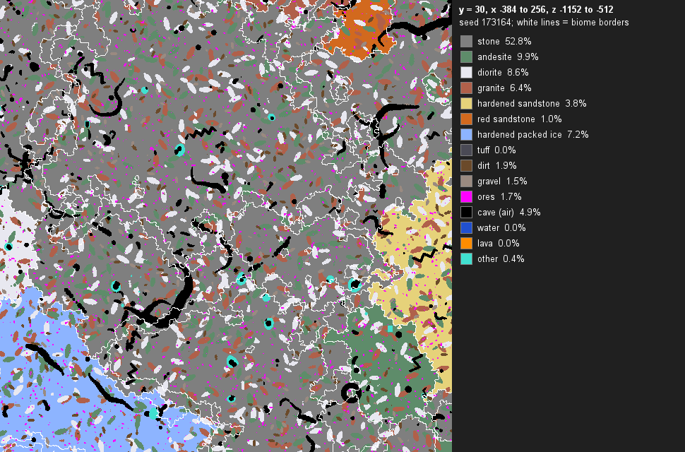

### What else depends on stone

Checked against everything Moderner Beta's biomes place in Eternal Return worlds:

- Fixed: water and lava springs (`spring_water`, `spring_lava_overworld`) and glow lichen only sit on a short list of stones; the two hardened blocks are added to those configured features. The hardened blocks don't exist outside Eternal Return worlds, so vanilla worlds are unchanged.
- Fixed: the stone blobs (granite, diorite, andesite, tuff, dirt, gravel) replace `#minecraft:base_stone_overworld`; the hardened blocks are in it. Ores reach every host stone through the ore variant hook (see Ore variants).
- Not changed, red sandstone: springs and glow lichen still skip it (adding it would change vanilla badlands), so badlands get fewer springs underground and no glow lichen.
- Fixed in part 2: lava lakes line themselves with a shell of plain stone where they touch solid ground. In Eternal Return worlds with biome stone on, the host stone stays instead (it is just as solid), so lakes leave no stone patches in host stone (`LakeFeatureMixin`).
- Fine as is: dungeons (their walls replace whatever solid block is there), fossils, amethyst geodes, buried diamonds and lapis, disks of sand, clay and gravel, magma under water. There is no infested stone: it only generates in vanilla's windswept hills and peaks, which Eternal Return doesn't use. Mineshafts and strongholds bring their own blocks; desert pyramids, igloos and the like sit on the surface.

### Progression

Nothing in a desert or cold biome drops cobblestone any more, so the stones the host stones drop become stone materials. These changes apply in every world, since they are recipes and item tags:

- `minecraft:stone_tool_materials` and `minecraft:stone_crafting_materials` now also hold sandstone, red sandstone, granite, diorite and andesite, so stone tools, furnaces and brewing stands accept them.
- The dispenser, dropper, lever, observer and piston recipes are replaced with copies that take `#minecraft:stone_crafting_materials` (any of the above, or cobblestone, blackstone, cobbled deepslate) instead of cobblestone.
- Packed ice is left out on purpose. In ice biomes the stone tools come from the granite, diorite and andesite blobs scattered through the ice underground (y 0 to 60), or from a neighbouring biome.
- Still need real cobblestone: cobblestone slabs, stairs and walls (crafted and stonecut), mossy cobblestone, smelting stone (so smooth stone, stone bricks, the stonecutter and the blast furnace go through cobblestone or stone), and the coast, sentry and vex armor trim templates.

## Ore variants (phase 4, part 2)

Every ore has its own version in every host stone: andesite, diorite, granite, red sandstone, hardened sandstone and hardened packed ice, times coal, iron, copper, gold, redstone, lapis, diamond and emerald, 48 blocks named `eternalreturn:<host>_<ore>_ore` (`eternalreturn:granite_iron_ore`, "Granite Iron Ore"). Plain stone keeps vanilla's ore blocks, and so do ores in tuff blobs.

### One table

`src/main/resources/eternalreturn/ore_variants.json` lists the ores (the vanilla stone ore, its deepslate ore, and its overlay image in `tools/ores/overlays/`) and the hosts (the block replaced, and its textures per face). The game reads it at startup to register the blocks (`OreVariants`); `tools/ores/build_ores.py` reads it, with the overlay images and the vanilla game files from the Gradle cache, to write everything else. A new ore or host stone is one entry plus a rerun of the script.

What the script writes, for every variant: its blockstate, block and item models, loot table, and the overlay texture of its ore; plus the tags and recipes below and the images in `docs/worldgen-maps/ores/`.

### Behaviour

- A variant is a copy of its vanilla stone ore: the same block class (experience-dropping, or redstone ore with its lighting, particles and light level 9), the same settings (hardness 3, blast resistance 3, pickaxe and tool tier, stone sounds) and the same experience range, with the host's map colour.
- Drops: the loot table is vanilla's for the stone ore with only the Silk Touch branch changed to give the variant, so normal mining, Fortune and explosions behave exactly like vanilla (raw iron, 2 to 5 raw copper, 4 to 9 lapis and so on). Pick-block gives the variant.
- Smelting and blasting: one recipe each per ore, copied from vanilla's for the stone ore (same result, experience and time), taking the item tag `eternalreturn:ore_variants/<ore>`.
- Tags: the vanilla `minecraft:<ore>_ores` block and item tags (Fabric's `c:ores` and `c:ores/<ore>` include those, so the variants are in them too), `minecraft:mineable/pickaxe`, and the `needs_stone_tool` or `needs_iron_tool` tag the vanilla ore is in. Vanilla's carver tag holds `#iron_ores` and `#copper_ores`, so those variants are carvable like their vanilla ores; carving runs before ores are placed anyway.
- Creative inventory: Natural Blocks, each ore's six variants right after its deepslate ore.
- Name: the host's name and the ore's name ("Hardened Sandstone Gold Ore"), from one language line, `block.eternalreturn.ore_variant`.

### Generation

Only in Eternal Return worlds with biome stone on. Every ore feature, vanilla's, Moderner Beta's or another mod's, writes its blocks in one place (`OreFeature.generateVeinPart`, and `ScatteredOreFeature` for scattered ores); a hook there (`OreFeatureMixin`, `ScatteredOreFeatureMixin`, `OrePlacement`) swaps the ore for the variant matching the block it replaces, from the table. For ores to reach the host stones at all, an ore feature's target test sees a host stone as plain stone. This replaces part 1's temporary fallback, which put hardened sandstone and hardened packed ice into the vanilla tag `minecraft:stone_ore_replaceables` and let red sandstone count as stone: now the vanilla ore tags are back to vanilla's (plus tuff), and nothing changes outside Eternal Return worlds. Natural granite, diorite and andesite blobs count as host stone wherever they are, so a granite blob under plains holds granite ores.

Lava lakes line themselves with plain stone where they meet solid ground; in host stone the host now stays (`LakeFeatureMixin`), so those patches, and the stone ores placed in them, are gone.

Ores counted over 4 x 4 fully decorated chunks in each of ten biomes (badlands, desert, ice plains, forest, jungle, birch forest, plains, extreme hills, savanna, taiga), before this change (recorded from the previous commit) and after. Every ore stays within 0.2 percent; the small differences are run-to-run noise (decoration order between neighbouring chunks), the same size as between two runs of identical code.

| Ore | Before | After | Change |
|---|---|---|---|
| coal | 19,189 | 19,191 | +0.01% |
| iron | 12,673 | 12,673 | 0 |
| copper | 14,784 | 14,787 | +0.02% |
| gold | 4,485 | 4,476 | -0.20% |
| redstone | 5,863 | 5,863 | 0 |
| lapis | 3,970 | 3,972 | +0.05% |
| diamond | 3,910 | 3,910 | 0 |

Where they are now ("stone" includes ores in tuff blobs and in plains, oceans and rivers):

| Ore | stone | andesite | diorite | granite | red sandstone | hard. sandstone | hard. packed ice |
|---|---|---|---|---|---|---|---|
| coal | 1,942 | 6,230 | 2,142 | 4,969 | 954 | 791 | 2,163 |
| iron | 1,698 | 3,662 | 1,655 | 2,730 | 979 | 880 | 1,069 |
| copper | 1,584 | 4,574 | 1,914 | 3,435 | 931 | 845 | 1,504 |
| gold | 683 | 1,070 | 433 | 788 | 738 | 342 | 422 |
| redstone | 999 | 1,692 | 581 | 920 | 568 | 530 | 573 |
| lapis | 551 | 1,176 | 505 | 713 | 312 | 326 | 389 |
| diamond | 675 | 1,068 | 366 | 669 | 372 | 370 | 390 |

Before the change 47,381 stone-textured ores sat inside host stone in these squares; now none do.

### Biome-specific ores

- Badlands extra gold (vanilla's `ore_gold_extra`: 50 more gold veins per chunk from y 32 to 256): still there. The badlands square holds 883 gold ores against 357 to 474 in the other nine biomes; they are red sandstone gold ore now.
- Emerald: vanilla's mountain emerald feature isn't used, because Eternal Return's extreme hills are Moderner Beta's `early_release_extreme_hills`. Moderner Beta gives that biome, and its plains, swampland and ice plains, its own emerald feature, `moderner_beta:ore_emerald_y95`: 11 tries per chunk of a vein of up to 8, from y 95 to the top of the world, 90 percent of the blocks dropped where they would touch air. So emerald generates in Eternal Return, but only in high ground. A survey of 24 x 24 chunks around the highest extreme hills within 3,000 blocks of spawn finds a few hundred emerald ores: 259 to 285 around 456, 2248 before cherry groves and the modern oceans reshuffled the biomes, 400 around 968, -2296 (ground at y 143; 17 percent of that square's ground at y 95 or higher), and 403 there after the third terrain pass, which left 11 percent of the square's ground at y 95 or higher; about half of them were andesite emerald ore and the rest in the plain stone of the biomes around. That was roughly 0.5 to 0.7 per chunk over the whole square, and about 3 to 6 per chunk's worth of ground above y 95. Since the fourth terrain pass the biome no longer makes the high ground, and the survey's result depends on which biomes happen to rise around the highest extreme hills: before the autumnal forest joined the biome pool they stood around 2184, -632 (ground at y 120) among mostly emerald-less biomes, and the square held 46 emeralds; with it they stand around 1352, -1400 (ground at y 139), 19,215 columns of the square reach y 95, and it holds 442 (141 in andesite, the rest in the plain stone of plains and swamps). Over the whole map, the ground where emerald can generate is about half what it was (see Terrain tuning). Release 1.6.4, by comparison, put 3 to 8 single emeralds per chunk below y 32 in extreme hills; vanilla 1.21's own mountain feature makes 100 tries per chunk (veins of up to 3) between y -16 and 480, so vanilla mountains hold far more. Nothing was added: emerald isn't missing, just rare and high. Raising it would be a new emerald feature for the extreme hills, in Eternal Return only. Since then the per-biome bonus ores (`OreBonuses`, see the README) give the extreme hills an emerald bonus of their own, and the survey finds 671 emeralds (378 in andesite).

### Textures: the old look

Each ore's overlay is a 16 x 16 image in the pre-1.14 style, `tools/ores/overlays/<ore>.png` (supplied by the project owner): coal, iron, copper, gold, redstone and diamond share one blob shape in their own colours, and lapis and emerald have shapes of their own, as the old ores did. Each pixel is either fully opaque or fully transparent, so the host stone shows through around the blobs; the script checks this and the size when it copies them into `assets/eternalreturn/textures/block/ore_overlay/`. The overlays have no dark edge, so a light ore on a light host (iron on diorite or sandstone, diamond on packed ice) or copper on red sandstone stands out less than on stone.

The block model draws the host's own texture on each face (sandstone's top, side and bottom faces where they differ) and the overlay on top, like a grass block's side overlay (`eternalreturn:block/ore_variant`, cutout render layer). The host texture is the game's `minecraft:block/andesite` and so on, so a resource pack that changes those (Golden Days, for one) changes the host under the ore too; the overlay is this mod's own and stays old-style either way.

- `docs/worldgen-maps/ores/contact_sheet.png`: every ore on every host face, plus plain stone for comparison (vanilla's own ores are untouched; plain stone is there only to judge the overlays).
- `docs/worldgen-maps/ores/overlays.png`: each ore's overlay on its own, over grey.

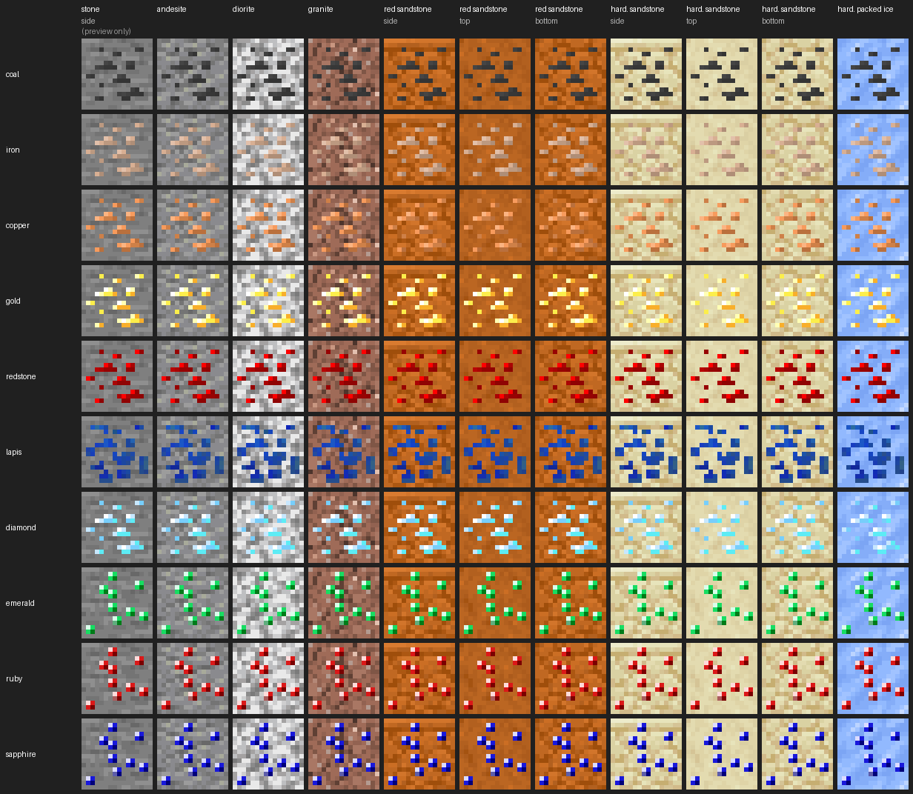

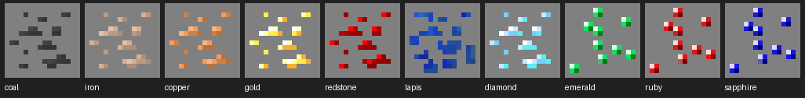

### Tests

- `runGametest` (flat; also without Moderner Beta), `OreVariantTests`: every variant against its vanilla ore: hardness, blast resistance, tool requirement, sounds, block class, experience range, tool-tier and pickaxe tags, the ore tags (vanilla's and `c:ores/<ore>`), pick-block and name; the loot table generates exactly vanilla's drops for 40 seeds, with a plain and a Fortune III pickaxe, and Silk Touch gives the variant; a survival player mining each variant ten times with a diamond pickaxe gets vanilla's drop and experience in vanilla's range, and with Silk Touch the variant and no experience; harvesting with wooden to diamond pickaxes matches vanilla; smelting and blasting give vanilla's result, experience and time; the creative tab places each variant after its deepslate ore; redstone variants light up to vanilla's light level and tick; and every ore has a 16 x 16 overlay with no half-transparent pixels, and every variant its blockstate and models.
- `runGametestEternalReturn`, `OreCensusTests`: the counts above against the baseline (`src/gametest/resources/ores/eternal_return.json`): within 1 percent per ore, the emerald survey within 15; no stone-textured ore inside host stone (an ore counts as inside when its own biome calls for a host stone and only host stone surrounds it, with no stone, tuff or fossil bone within two blocks: tuff keeps stone ores, fossils turn some bone into coal or diamond ore, and at biome borders a river's plain stone can run in a thin strip between host stone); variants of every host open to caves (cave walls show them); and a fresh desert square generated with biome stone off has no host stones and only vanilla ores.
- Control runs (vanilla; Moderner Beta's 1.6.4, 1.6.4 amplified and Beta 1.7.3 presets; Eternal Return with biome stone off): besides the carved-terrain fingerprints, which all still match, each now decorates three more groups of chunks (ores, plants, structures), one chunk at a time in a fixed order. In the vanilla world those decorated chunks are hashed and match a fingerprint recorded from the code before this change (`vanilla_tunnel_features.json`). Moderner Beta's decoration does not repeat from run to run, even with the old code and the fixed order (two runs differ in their tuff, deepslate and clay blobs and lush-cave plants), so in its worlds the test checks instead that none of this mod's blocks (ore variants, hardened blocks) appear. Both hold: nothing changed outside Eternal Return worlds with biome stone on.

### Notes

- Ore counts move a little between runs of identical code (up to 0.2 percent for the big ores, about 10 percent for the few hundred emeralds of the survey): a chunk's features also write into its neighbours, and the order chunks are decorated in depends on thread timing. The census uses squares whose neighbours are all decorated, which removes edge effects but not this.
- The debug-tunnel check (`WorldgenTests`) failed once while every test world ran at the same time. Run alone five times and with all worlds together three times, it passed every time, but the tunnel's first ocean chunk was open in only 114 to 142 of its 144 cells: the rest were plants (moss carpet, azalea, grass, vines, glow lichen) dropped in by decoration of the neighbouring lush caves, and how many depends on which neighbouring chunks happen to be decorated when the row is read, alone or not. Not contention, not carving. The check now decorates every neighbour of each chunk first and counts plants as open, so only rock left in the tunnel fails it.

## Mineshafts (phase 4, part 3)

In Eternal Return worlds, a mineshaft is built from the wood of the biome it starts in: its signature tree, one wood per biome.

| Wood | Biomes |
|---|---|
| birch | birch forest |
| spruce | taiga |
| jungle | jungle |
| acacia | savanna |
| dark oak | dark forest |
| cherry | cherry grove |
| oak | every other biome, treeless ones too (desert, plains, oceans, badlands...) |

The table is data: one biome tag per wood, `eternalreturn:mineshaft_wood/<wood>` (oak has none: it is the default). A new wood is one entry in `MineshaftWoods.WOODS` plus its tag.

**How.** Vanilla mineshafts only know two woods, oak and the badlands "mesa" dark oak, through a type every piece reads its logs, planks and fences from. In Eternal Return worlds, when a mineshaft is laid out (`MineshaftStructureMixin`), its wood is picked from the biome at its start, and every piece remembers it (`MineshaftPartMixin`, saved with the piece under `eternalreturn_wood`) and builds from it (`MineshaftPiecesMixin`). Rails, cobwebs, chests and spawners are unchanged. In other worlds pieces carry no wood and build as vanilla.

**More mineshafts.** Vanilla's mineshaft biome tag lists vanilla biomes, so Moderner Beta's extreme hills, ice plains, swampland and plains had no mineshafts at all. In Eternal Return worlds ordinary mineshafts may also start in the biomes of `eternalreturn:has_structure/mineshaft` (`StructureMixin`); the tag isn't used anywhere else, so Moderner Beta's own presets keep their mineshafts as they were. Badlands keep vanilla's badlands mineshaft, built from oak like other treeless biomes.

Over 500 x 500 chunks of the test seed: 1,060 mineshafts, 841 oak, 79 spruce, 40 jungle, 28 birch, 27 acacia, 26 dark oak and 19 cherry, and 38 to 80 each under Moderner Beta's extreme hills, ice plains, swampland and plains.

### Tests

- `runGametestEternalReturn`, `MineshaftAndOceanTests`: every mineshaft start within 250 chunks of spawn, found the way the generator places them (the structure set's placement, then the structure's own start, through the same code and hooks the generator uses), has its biome's wood in every piece; every wood turns up; mineshafts start in each of Moderner Beta's four extra biomes. The nearest mineshaft of each wood under land is then built into fully generated terrain with the game's own piece code: over a thousand of its own planks and fences, none of another wood, and its pieces save their wood. Test worlds are made with structures switched off (vanilla's test server does that), so the test places them itself. The same test class checks that all nine oceans and cherry groves appear within 4,000 blocks and logs the spots used in the README checklist.
- Moderner Beta's list of the biomes a world can produce misses the deep cold, deep frozen and deep lukewarm oceans its ocean climate step makes. Its height table follows that list, so those oceans (and the deep warm one) first came out as land hills reporting an ocean biome; the preset now sets every ocean's height (see Oceans), and `CoastTests` checks over 8,000 x 8,000 blocks that dry land reports an ocean biome only in a handful of coastal columns a block or two above the water, where Moderner Beta blends heights across a border (Release 1.6.4 did the same). Fabric also attaches carvers only to listed biomes, so at first those oceans got no caves at all (a debug-tunnel check and two cave-type squares came up nearly empty). The cave carver and the debug tunnel are now attached to those three by name as well (`WorldgenFeatures`); they are vanilla overworld biomes, so other worlds are unchanged. A new cave test checks that every biome the world can produce, listed or not, carries the cave carver.
- The ore census and the old-caves carving fingerprint were recorded again, since adding a biome moves every land biome; everything else in those runs is unchanged.

## The outer End

Code: `com.eternalreturn.worldgen.end`. Only the End of a world made with the Eternal Return world type since this came in: a world saves the End generator it was made with, so older Eternal Return worlds keep vanilla's End.

**Moderner Beta.** It doesn't touch the End. Its own world preset and ours both give the End vanilla's generator (`minecraft:noise`, the `the_end` biome source); its `surface_config/end.json` is read only by its own generator, which never runs there; none of its mixins reach End generation. Nothing to conflict with.

**What it looks like.** Past the void round the main island, the outer islands are replaced (see the README for the player's view). The world is split into squares of 160 blocks (`OuterEndTerrain.CELL`); `islandChance` of them (0.85) hold a group, the rest a few fragments. A group is:
- a main island, an oval (round to 1.7 times as long as wide) with a ragged edge, mostly 32 to 100 blocks across, one in eight 100 to 150; its rim at its own height: `lowIslandShare` (0.15) of them between `islandMinY` (22) and 25 above it, `highIslandShare` (0.18) between `islandMaxY` (185) and 35 below it, the rest round `islandMiddleY` (95), give or take about 50, drifting with a regional noise so neighbours are related;
- one to four flat steps rising towards its middle, whose edges wander; sides undercut below the rim (rough 3D noise); an underside hanging in crags up to 60 blocks below, deepest under the middle;
- spires on it (a quarter of them hanging from its underside instead), more on a big island;
- up to four smaller islands stacked 18 to 48 blocks above or below it, a third of those above joined to it by a pillar;
- 5 to 20 or so fragments (small lumpy ellipsoids, now and then up to 8 blocks) drifting round it.

On the test seed (12,000 x 12,000 blocks): 4,902 islands, 16 percent low (under y 55), 66 percent in the middle band (60 to 140), 17 percent high (over 150). The gap from an island's edge to its nearest neighbour's is 64 blocks at the median and 95 at the 90th percentile, with fragments between.

**How.** `tools/worldgen/build_preset.py` writes `eternalreturn:eternal_return_end`: vanilla's `end.json` with the noise up to y 256 (the top of the End), the final density wrapped in `eternalreturn:outer_end` and the erosion (which the End's biome source reads) replaced by `eternalreturn:outer_end_biome`. `OuterEndDensity` returns vanilla's own density within 1,000 blocks of 0, 0 below y 128 (vanilla's End has nothing above), so the main island, its pillars, portal and gateways come out block for block. Past that it returns `OuterEndTerrain.density`, a pure function of the seed (drawn from the `eternalreturn:outer_end` noise, the only way a density function sees the seed) and the settings. It is worked out per block, not interpolated over vanilla's 8 x 4 x 8 cells, so thin spires keep their shape; each thread keeps the current chunk's shapes and columns, and a block outside every shape's height range costs one comparison. Being the terrain's own density, End cities, the exit gateways' landing search and heightmaps all see the new islands.

Biomes: `OuterEndTerrain.biomeValue`, read at each chunk's middle: highlands in the middle of a main island, midlands on the rest of an island, barrens over fragments and the void, and barrens on islands whose top is over y 150 (an End city there would run into the top of the world). Never small_end_islands, whose vanilla islands would sit in a flat layer at y 55 to 70. Vanilla's chorus grows in highlands; `outer_end_chorus_plant` (vanilla's chorus feature, up to 3 a chunk, only on an outer island's top and not in highlands: `OuterEnd.OnOuterIsland`) gives the other islands theirs.

**Megastructures.** `Megastructures`: at most one in each square of `megastructureSpacing` (320) blocks, in `megastructureChance` (0.55) of them, `massiveChance` (0.1) of those massive. Kinds: ring (round or square cross-section, tilted 20 to 85 degrees), monolith (a tall slab tilted 6 to 32 degrees), cube (tumbled any way, or nearly upright; hollow when big), pyramid (a quarter upside down; hollow when big), arch (a half ring on two legs), shards (three to seven pointed crystals from one root). Each is signed distance functions in its own frame, then broken:
- one to three cuts (two to four on a massive one); past each, the piece is gone (at most one per structure) or drifted off and tilted (up to about 23 degrees);
- two to nine round bites out of its surface;
- cracks: thin sheets where a noise crosses zero;
- rubble: 8 to 70 tumbled lumps on the island ground round it, or adrift by it over the void.

Crying obsidian comes in veins (one noise near zero) and patches (another high), about `cryingObsidianRatio` (0.2) of it, more on broken faces. Amethyst clusters and buds (never blocks) grow into air next to a broken face (a cut, a bite, a crack), at `amethystDensity` 1.0 in about one in five such spots. Three in four are placed by an island (up to 24 tries for a spot with ground under it): 42 percent sunk into it, 43 percent resting on it, 15 percent floating over it; the rest float over the void. On the test seed, within 4,000 blocks: 265, 14 of them massive; 92 embedded, 69 resting, 104 floating. The nearest three are 14 percent crying obsidian, with 656 amethyst clusters and buds.

Kept clear of:
- the exit gateways' landing ring: nothing within 1,400 blocks of 0, 0 (gateways land 1,024 blocks out and search up to 256 further);
- End cities: their structure placement is worked out as the game does it, and any start chunk within the structure's reach plus 96 blocks whose middle is highlands or midlands shrinks the structure once, then drops it.

The feature (`MegastructureFeature`, step `local_modifications`, empty in vanilla's End) runs before return gateways and chorus, so those sit on top of it. It replaces only air and end stone and writes only into its own chunk, from the same pure function, so the parts line up in any chunk order.

**Other worlds.** Both features are added to every End biome, in steps where they come after anything vanilla's End has, and do nothing outside Eternal Return's End, so no other world's End changes.

**Timing.** Full chunk generation, 8 x 8 fresh chunks at a time: 24 to 28 ms a chunk in the outer End, against 8 to 13 ms for vanilla's code over the void round the main island (`outerEndChunksAreQuick`). Checked in game with Sodium 0.8.13 (runClientCompat).

### Maps

`./gradlew runWorldmapEnd` (part of `generateWorldMaps`) writes `docs/worldgen-maps/outer_end/`: `islands.png`, 2,048 blocks square east of the main island from above, coloured by height (low purple to high yellow), megastructures dark; `megastructures.png`, one of each kind and two massive ones seen from the south (the structure and the terrain level with it or behind it, darker further back).

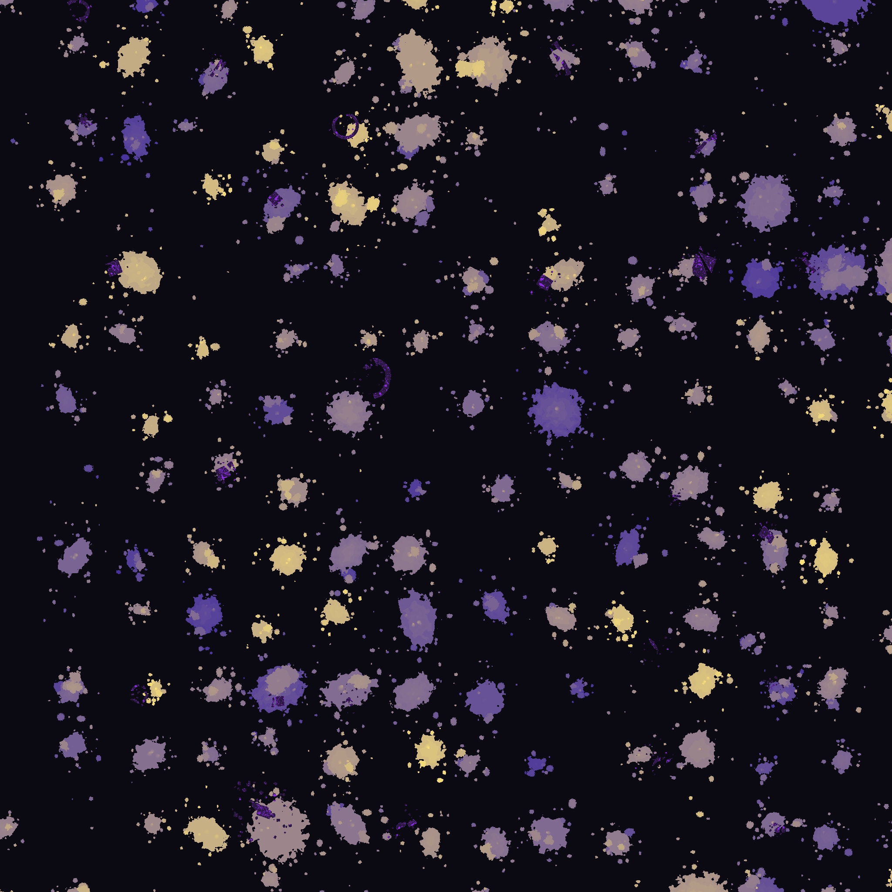

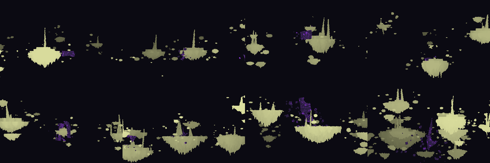

### Tests

`OuterEndTests`, batch `outer_end` in `runGametestEternalReturn`:
- `innerEndIsVanilla`: within 1,000 blocks of 0, 0, the density equals vanilla's End density at 234,221 points, and nothing is solid above y 128;
- `outerIslandsSpreadInHeight`: over 1,000 islands within 6,000 blocks, none in the void gap, more than 8 percent low and high each and half in the middle band, the 90th percentile gap under 140 blocks;
- `outerIslandsGenerateAsPlanned`: the nearest four islands generated in full; every air and end stone block of their middle chunk matches the density;
- `chorusGrowsOnIslands`: chorus on a big highlands island and on a high island;
- `megastructuresAreShattered`: every kind and setting turns up; none in the landing ring; the nearest three built: crying obsidian 6 to 45 percent, amethyst clusters and buds but no amethyst blocks, no End city within reach (by the game's own locate);
- `outerEndChunksAreQuick`: under 80 ms a chunk.

## Phase 1 findings (Moderner Beta 5.0.0-alpha.2)

Sources: the mod's shipped data and its source (Codeberg, tag `5.0.0-alpha.2`). The official docs site (moderner.nostalgica.net) has no DNS record and the Codeberg wiki is empty.

**Settings are data.** A world is three settings blocks (chunk, biome, cave biome), usually pointing at a settings preset such as `moderner_beta:release_1_6_4_amplified`. Presets are a datapack registry (`data/<namespace>/moderner_beta/settings_preset/*.json`), so this mod can ship its own preset and world preset as plain data, with no code dependency.

**Terrain.** Beta 1.7.3 and Release 1.6.4 use the same `noise_3d` terrain engine. 1.6.4 turns on `forced_biome_height` (each biome's depth and scale shape the land; this is where continents and oceans come from) and weakens the random depth noise (`noise_landmass.depth.influence` 0.2). Beta has no forced height and full-strength depth noise (influence 1.0). Phase 2 tested the blend; see Terrain tuning.

**Biomes.** Release presets use a `fractal_layers` pipeline, the old GenLayer stack, written out in the preset: `random_biome` pools, `biome_replacement`, `weighted_pool`, hills, shores, rivers. Trimming or adding biomes means editing those lists in our own preset. Beta-style presets also have `biome_injection_rules`. A 1.6.4 world uses vanilla `desert`, `forest`, `jungle`, `ocean`, `frozen_ocean`, `river`, `frozen_river`, `beach`, `mushroom_fields`, plus Moderner Beta's own `early_release_ice_plains`, `early_release_taiga`, `early_release_swampland`, `early_release_extreme_hills`, `late_beta_plains`. A cave-biome layer adds `lush_caves`, `dripstone_caves` and `deep_dark` underground. Moderner Beta's own biomes are not in vanilla tags such as `#minecraft:is_overworld`.

**Caves.** `chunkSettings.cave_generation` has `useCarvers` (master switch: off skips every carver, ours included), `forceBetaCaves` / `forceBetaCanyons` (swap vanilla's `cave`, `cave_extra_underground` and `canyon` carvers for Beta versions), `useNoiseCaves` and `fixCaveBorders`. Its `applyCarvers` loops over each nearby chunk's biome carvers like vanilla does, so carvers added through Fabric biome modifications run. Proven by the debug tunnel test (see README, Tests). Removing vanilla's cave carvers from biomes should also remove the Beta caves that replace them (from reading the code; untested). Phase 3 skips them at carve time instead, in Eternal Return worlds only (see The cave engine).

**World height.** Moderner Beta ships an optional "Reduced Height" datapack that moves the overworld floor to y=0, like old versions. It is off unless chosen at world creation. Without it, the world keeps the normal -64 floor. Moderner Beta's own presets cap terrain at y=128 even so; the Eternal Return preset uses the full range (see above).

## Existing features that depend on biomes

Checked against a Moderner Beta Release 1.6.4 world in phase 1, fixed in phase 2.

- Fish (the fish table, `eternalreturn/fish.json`; see [fish.md](fish.md)): each habitat's biome tag (`fish_habitat/<habitat>`) lists vanilla's biomes of that kind and Moderner Beta's (every generation: early release, late Beta, Beta, Pocket Edition, Alpha, Indev) as optional entries, so the tags load without it. Deep-water fish need enough water straight down from the hook rather than a deep ocean biome; on the test maps, half of all water is at least 13 blocks deep in Eternal Return (12 in 1.6.4, 2 in Beta).
- Villager regions: vanilla only gives its own biomes a region (snow, taiga, swamp...), so villagers in Moderner Beta's biomes were all plains villagers. `VillagerRegions` maps Moderner Beta's ice plains, tundras, taigas, extreme hills, swamplands, deserts, savannas and rainforests to vanilla's region for that kind of biome. The region decides which fish a fisherman buys.
- Spider jockey riders (weighted by the biome's monster spawn list): fine. Vanilla `desert` spawns husks, and Moderner Beta's ice plains spawn strays (weight 80), so strays on polar bears still happen there.
- Cave-only creepers (sky light 0): creepers only spawn where no sky light reaches. Cave types open to the sky (ravines, vertical shafts, big caverns with openings) won't get creepers near their openings; deep enclosed rooms will.
